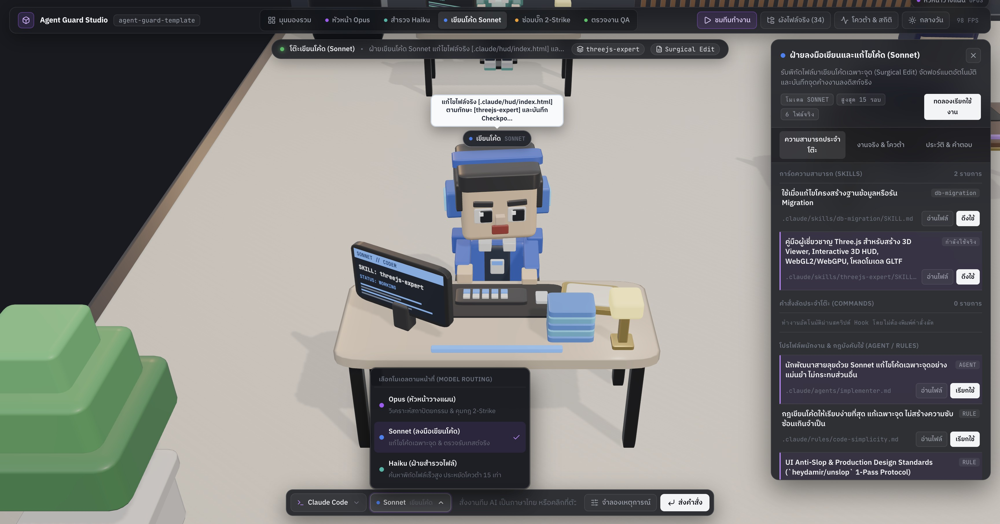
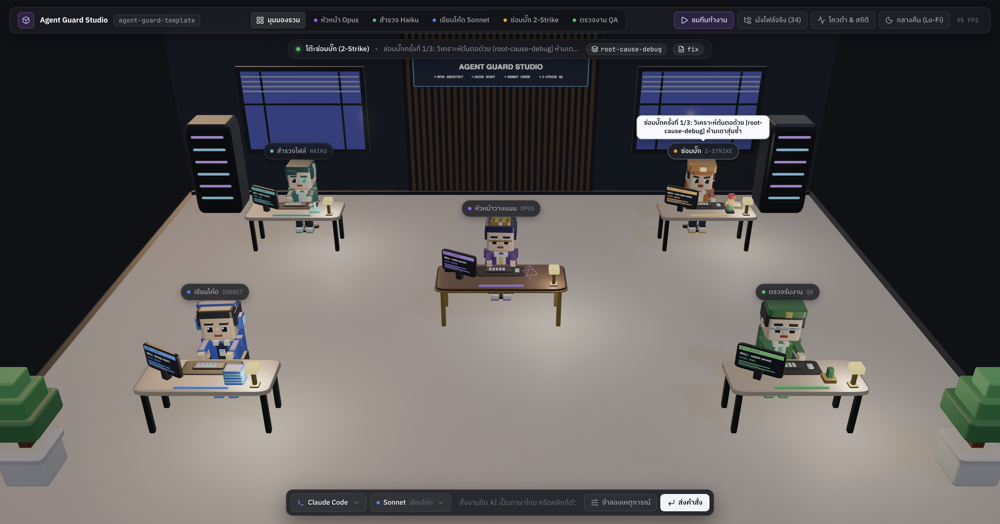
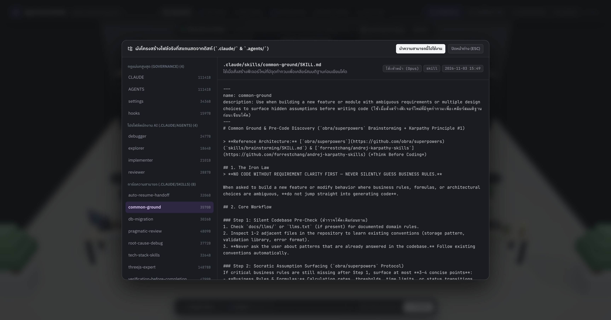

# 🛡️ Agent Guard Template

**Template ตั้งต้นสำหรับใช้ AI เขียนโค้ดแบบทีม 5 แผนก พร้อมศูนย์บัญชาการ 3D Voxel Studio (รองรับทั้ง Claude Code และ Antigravity IDE)**

ช่วยให้ AI ทำงานตามสั่งอย่างตรงจุด **ไม่เดามั่ว ไม่วนลูปผลาญโควต้า ไม่เขียนโค้ดเวิ่นเว้อ** และสามารถ **สลับโปรแกรมทำต่อได้ทันทีเมื่อโควต้าฝั่งใดฝั่งหนึ่งหมดกลางคัน** โดยที่คุณไม่ต้องจำคำสั่งพิเศษใดๆ (พิมพ์สั่งงานด้วยภาษาพูดตามปกติได้เลย)


---

## 🤔 ทำไมต้องใช้ Template นี้? (เปรียบเทียบให้เห็นภาพ)

เวลาเราใช้ AI เขียนโค้ดในโปรเจกต์เปล่าๆ เรามักเจอปัญหาเหล่านี้:

| ปัญหาที่เจอประจำ (เมื่อไม่ใช้ Template) | สิ่งที่เกิดขึ้นเมื่อใช้ `agent-guard-template` |
| :--- | :--- |
| 💸 **เปลืองโควต้าฟรี:** สั่งแก้บั๊กนิดเดียว แต่ AI เดาแก้แล้วรันเทสต์พังวนไป 10 รอบจนโควต้าหมด | 🛑 **หยุดเมื่อตัน (2-Strike Limit):** ถ้า AI ลองแก้ 2 ครั้งแล้วยังไม่ผ่าน ระบบจะบังคับหยุด คืนค่าไฟล์เดิม แล้วสรุปทางเลือกมาถามคุณทันที |
| 🤯 **คิดเองเออเอง:** สั่งทำฟีเจอร์สั้นๆ AI ดันคิดสูตรธุรกิจเองมั่วๆ พอทำเสร็จต้องสั่งรื้อใหม่หมด | 🤝 **ถามก่อนมั่ว (`common-ground` & `0-Strike`):** ถ้าข้อมูลสำคัญขาดหาย AI จะสรุปสิ่งที่มันเข้าใจ 3–4 ข้อมาถามคุณสั้นๆ ก่อนลงมือเขียนโค้ด |
| 🐘 **โค้ดบวมเกินสั่ง:** สั่งแก้ปุ่มเดียว แต่ AI แถมเปลี่ยนชื่อตัวแปรและรื้อไฟล์ข้างเคียงมาให้เพียบ | ✂️ **แก้เฉพาะจุด (Surgical Edit):** แก้เฉพาะบรรทัดที่สั่ง ไม่แตะโค้ดส่วนอื่นที่ไม่ได้ขอ (จากการทดสอบจริงช่วยลดโค้ดส่วนเกินลง 40–65%) |
| 🎨 **หน้าเว็บ/แอปดูเป็น AI ราคาถูก:** ชอบใช้สีม่วงไล่เฉด วาด `<svg>` เบี้ยวๆ เอง หรือเอา Emoji มาแปะแทนไอคอน | ✨ **สวยระดับ Production ในรอบเดียว (`ui-anti-slop`):** บังคับเกณฑ์ออกแบบ 9 ด้านอัตโนมัติเมื่อแตะไฟล์เว็บ/Flutter (ใช้ `lucide-react` / `lucide_icons` ห้ามวาด SVG เอง) |
| 🔄 **รีวิวไม่รู้จบ:** พอสั่งให้ตรวจโค้ด ก็จับผิดเรื่องจุกจิก (เช่น ชื่อตัวแปร/ย่อหน้า) แก้ไปมาไม่จบสักที | ✅ **ตรวจเฉพาะจุดตาย (Blocker-Only):** ตรวจเฉพาะบั๊กที่ทำให้ระบบพังหรือรั่วไหล พอแก้เสร็จและเทสต์ผ่านจะอนุมัติ (`APPROVE`) จบงานใน 2 รอบ |
| 🔌 **โควต้าตัดกลางอากาศ:** กำลังทำค้างไว้ใน Claude Code แล้วโควต้าหมด ต้องมานั่งพิมพ์เล่าใหม่ใน VS Code | 🏃 **ส่งไม้ต่ออัตโนมัติ (Auto-Handoff):** บันทึกจุดที่แก้ค้างไว้ทุกครั้งอัตโนมัติ พอเปิดอีกโปรแกรมขึ้นมา แค่พิมพ์ว่า *"ทำต่อเลย"* ก็ลุยต่อได้ทันที |

---

## 🛠️ เครื่องมือพื้นฐานที่ต้องมีในเครื่อง (Prerequisites & CLI Tools)

ตัว Template ออกแบบให้เป็น **Zero-Dependency (ไม่ต้องรัน `npm install` หรือ `pip install` ลงในโปรเจกต์ และไม่สร้างโฟลเดอร์ `node_modules`)** โดยแบ่งเครื่องมือที่ใช้เป็น 3 กลุ่มชัดเจนดังนี้ครับ:

### 1. เครื่องมือระบบพื้นฐาน (จำเป็น — มักติดมากับ macOS / Linux / WSL อยู่แล้ว)
| เครื่องมือ | ใช้ทำอะไรใน Template นี้? | วิธีเช็กว่ามีหรือยัง |
| :--- | :--- | :--- |
| **`bash`** | รันสคริปต์ยามรักษาความปลอดภัย 8 ตัวใน `.claude/hooks/*.sh` | `bash --version` |
| **`python3`** | เปิดเว็บเซิร์ฟเวอร์สำหรับหน้าจอ **3D Voxel Studio** (`open-hud.sh` ใช้เฉพาะ Standard Library ไม่ต้องลงแพ็กเกจเสริม) | `python3 --version` |
| **`git`** | ตรวจนับบรรทัดที่แก้ไขจริง (`git diff`), บันทึกจุดค้างงานลง `.agent-last-state.log`, และดึง Skill เสริมผ่าน `install-skill.sh` | `git --version` |

### 2. เครื่องมือ AI CLI / IDE (ติดตั้งอย่างน้อย 1 ค่ายตามที่คุณใช้งานจริง)
| เครื่องมือ | ใช้ทำอะไรใน Template นี้? | วิธีติดตั้ง / เชื่อมต่อ |
| :--- | :--- | :--- |
| **Claude Code CLI (`claude`)** หรือ **VS Code Extension** | ใช้งานระบบกฎ `.claude/`, ลูกมือ 4 ตำแหน่ง (`.claude/agents/`), สั่งงานจากช่องแชทล่างจอ 3D และดึง **% โควต้าคงเหลือราย 5 ชม. จริง** | `npm install -g @anthropic-ai/claude-code` แล้วรัน `claude` เพื่อ Login |
| **Antigravity IDE / CLI (`agy`)** | ใช้งานระบบกฎ `.agents/` ใน Antigravity IDE, รับไม้ต่องานค้างอัตโนมัติเมื่อโควต้า Claude เต็ม และเช็กโควต้าฝั่ง Antigravity | ติดตั้งผ่านโปรแกรม Antigravity IDE (มีคำสั่ง `agy` ให้ในตัว) |

> 💡 **หมายเหตุ:** ต่อให้เครื่องของคุณยังไม่ได้ติดตั้ง `claude` หรือ `agy` คุณก็ยังสามารถรัน `bash .claude/hooks/open-hud.sh` เพื่อเปิดหน้าจอ **3D Voxel Studio** สำรวจผังไฟล์จริงทั้ง 34 รายการ และกดปุ่ม **"จำลองเหตุการณ์"** เพื่อดูการทำงานของทีม AI ทั้ง 5 แผนกได้ทันที

### 3. เครื่องมือจัด Format โค้ดอัตโนมัติ (ไม่บังคับ — มีเฉพาะภาษาที่โปรเจกต์คุณใช้จริง)
สคริปต์ `post-edit-format.sh` จะตรวจหา Formatter ในเครื่องอัตโนมัติเมื่อ AI แก้ไฟล์ภาษานั้นๆ **(ถ้าไม่มีในเครื่อง สคริปต์จะข้ามไปอย่างปลอดภัย ไม่เกิด Error ใดๆ)**:
* **JavaScript / TypeScript / JSON:** `prettier` (ตรวจจาก `node_modules/.bin/prettier` ของโปรเจกต์)
* **Go:** `gofmt` (มากับชุดติดตั้ง Go มาตรฐาน)
* **Flutter / Dart:** `dart format` (มากับ Flutter SDK)
* **Python:** `ruff` (`pip install ruff` หรือ `brew install ruff`)
* **Rust:** `rustfmt` (มากับ `rustup`)

---

## 🚀 วิธีติดตั้ง (ใช้เวลาไม่ถึง 2 นาที)

### วิธีที่ 1: เริ่มโปรเจกต์ใหม่
กดปุ่มสีเขียว **"Use this template"** ด้านบนของหน้า GitHub นี้ หรือรันคำสั่ง:
```bash
git clone https://github.com/bosocmputer/agent-guard-template.git my-project
cd my-project
chmod +x .claude/hooks/*.sh
```

### วิธีที่ 2: นำไปใส่ในโปรเจกต์เดิมที่มีอยู่แล้ว
ก๊อปปี้แค่ 5 ส่วนนี้ไปวางที่โฟลเดอร์นอกสุด (Root) ของโปรเจกต์คุณ:
1. ไฟล์ `AGENTS.md`
2. ไฟล์ `CLAUDE.md`
3. ไฟล์ `GEMINI.md`
4. โฟลเดอร์ `.agents/`
5. โฟลเดอร์ `.claude/`

จากนั้นรันคำสั่งเปิดสิทธิ์สคริปต์ 1 ครั้ง:
```bash
chmod +x .claude/hooks/*.sh
```

### วิธีที่ 3: อัปเดตโปรเจกต์เดิมที่ใช้ Template เวอร์ชันเก่าอยู่แล้ว
รันคำสั่งนี้ที่โฟลเดอร์นอกสุดของโปรเจกต์เดิม เพื่ออัปเดตเฉพาะไฟล์มาตรฐานของ Template โดย**ไม่ลบ** Skill เสริมที่เคยดึงเพิ่มไว้ (`install-skill.sh`) และไม่กระทบโค้ดในโปรเจกต์:
```bash
git clone --depth 1 https://github.com/bosocmputer/agent-guard-template.git /tmp/agt-update && \
rsync -a /tmp/agt-update/CLAUDE.md /tmp/agt-update/AGENTS.md /tmp/agt-update/GEMINI.md /tmp/agt-update/.claude /tmp/agt-update/.agents ./ && \
chmod +x .claude/hooks/*.sh && \
rm -rf /tmp/agt-update
```

---

## 🖥️ ศูนย์บัญชาการ 3D Voxel Studio (`Agent Guard Voxel Studio`) — คืออะไร และทำงานอย่างไร?

Template นี้มาพร้อมหน้าจอ **Agent Guard Voxel Studio** (สร้างด้วย [`mrdoob/three.js`](https://github.com/mrdoob/three.js) `r187` แบบไฟล์เดียวจบใน [`.claude/hud/index.html`](.claude/hud/index.html) ไม่ต้อง `npm install`) ซึ่งจำลอง **ห้องทำงานของทีมวิศวกร AI ทั้ง 5 แผนกในรูปแบบ 3D Voxel** ที่เชื่อมโยงกับไฟล์จริงและเหตุการณ์จริงในโปรเจกต์ของคุณแบบ 100% (ไม่มีการ Hardcode รายการไฟล์)

### วิธีเปิดหน้าจอ 3D Voxel Studio:
รันคำสั่งนี้ใน Terminal ที่โฟลเดอร์โปรเจกต์ (เปิดเบราว์เซอร์ไปที่ `http://127.0.0.1:4317/` ให้อัตโนมัติ):
```bash
bash .claude/hooks/open-hud.sh
```

---

### 🔍 เจาะลึก 4 มุมมองหลักของ 3D Voxel Studio

#### 1. มุมมองภาพรวมสตูดิโอ 5 แผนก (`Full-Screen 3D Studio Overview`)


* **คืออะไร:** หน้าจอหลักแบบ 100% Full-Screen ที่แบ่งทีม AI ออกเป็น **5 โต๊ะทำงานตามหน้าที่จริง** เพื่อให้คนทั่วไปเข้าใจทันทีว่าทำไมโควต้าถึงประหยัดลงและทำไม AI ถึงไม่แก้โค้ดมั่ว:
  1. **โต๊ะกลาง — หัวหน้าวางแผน (`Opus Architect`):** วิเคราะห์โจทย์ใหญ่ ตั้งสมมติฐาน (`common-ground`) แจกงานให้ลูกทีม และคุมกฎความปลอดภัย
  2. **โต๊ะซ้ายบน — ฝ่ายสำรวจไฟล์ (`Haiku Scout`):** วิ่งค้นหาพิกัดไฟล์ (`Read / Grep / Glob`) แบบอ่านอย่างเดียวด้วยความเร็วสูง **ประหยัดโควต้ากว่า Opus 15 เท่า**
  3. **โต๊ะซ้ายล่าง — ฝ่ายลงมือเขียนโค้ด (`Sonnet Coder`):** รับพิกัดบรรทัดมาแก้โค้ดเฉพาะจุด (`Surgical Edit`) พร้อมกองแฟ้มงาน 3D บนโต๊ะที่เพิ่มขึ้นตามจำนวนไฟล์จริงที่ถูกแก้ไข
  4. **โต๊ะขวาบน — ช่างซ่อมบั๊ก (`2-Strike Debugger`):** วิเคราะห์ต้นตอบั๊กพร้อม **เสาไฟสัญญาณ 3 ระดับ (เขียว ➔ ส้ม ➔ แดง)** บนโต๊ะ หากแก้พังครบ 2 ครั้งแล้วยังไม่ผ่าน เบรกเกอร์จะตัดทันทีเพื่อไม่ให้ผลาญโควต้าฟรี
  5. **โต๊ะขวาล่าง — ฝ่ายตรวจรับงาน (`Sonnet QA Verifier`):** รันคำสั่งเทสต์จริงและเช็กว่ามีเทสต์ถูกรันจริงก่อนส่งมอบงาน
* **ทำงานอย่างไร:** ทุกครั้งที่ AI ใน CLI เริ่มทำงาน สคริปต์ Hook (`telemetry-tracker.sh`) จะส่งสัญญาณมาที่ฉาก 3D ทำให้ **แฟ้มงานสีทอง 3D ลอยส่งต่อข้ามโต๊ะ**, หน้าจอมอนิเตอร์จิ๋วบนโต๊ะเปลี่ยนชื่อ Skill สดๆ, และตัวละครพูดสถานะงานปัจจุบันเป็นภาษาไทย

---

#### 2. คลิกที่ตัวละครเพื่อเปิดดูการ์ดความสามารถประจำโต๊ะ + เลือกโมเดล (`Progressive Disclosure Drawer & Custom Select`)


* **คืออะไร:** แทนที่จะเทตัวหนังสือทุกอย่างไว้เต็มหน้าจอ ระบบใช้หลัก **Progressive Disclosure 3 ระดับ**:
  * เมื่อคลิกที่ **ตัวละคร 3D** หรือปุ่มชื่อโต๊ะด้านบน กล้องจะซูมเข้าไปหาตัวละครนั้น (ตัวละครจะหันมามองกล้อง) พร้อมสไลด์เปิด **แผงข้อมูลประจำโต๊ะ (`Slide-Over Context Drawer`)** ทางด้านขวา
  * แสดงรายการ **การ์ดความสามารถ (`Skills`)**, **คำสั่งลัด (`Commands`)**, และ **กฎประจำตำแหน่ง (`Agent / Rules`)** ที่สแกนสดจากโฟลเดอร์ `.claude/` และ `.agents/`
  * ด้านล่างมี **Custom Select Popover Component** สำหรับเลือกสลับค่าย (`Claude Code` / `Antigravity`) และเลือกโมเดล (`Opus`, `Sonnet`, `Haiku`) หรือพิมพ์สั่งงานเป็นภาษาไทยได้โดยตรง

---

#### 3. โหมดบรรยากาศกลางคืน (`Cozy Lo-Fi Night Mode`) & ระบบตัดเบรกเกอร์ `2-Strike`


* **คืออะไร:** กดปุ่ม **`กลางวัน / กลางคืน (Lo-Fi)`** ที่มุมขวาบนเพื่อสลับบรรยากาศห้องทำงานเป็นโหมดกลางคืน ท้องฟ้าด้านนอกหน้าต่าง Loft จะเปลี่ยนเป็นสีน้ำเงินเข้ม พร้อมเปิดไฟโคมตั้งโต๊ะทองเหลือง (`PointLight`) ให้แสงอบอุ่นสบายตาขณะเปิดมอนิเตอร์ทิ้งไว้ข้างจอเขียนโค้ด
* **ทดลองจำลองเหตุการณ์ได้ทันที:** กดปุ่ม **`ชมทีมทำงาน`** (ด้านบน) เพื่อดูแอนิเมชันส่งต่องานครบทั้ง 5 แผนกอัตโนมัติ หรือกดปุ่ม **`จำลองเหตุการณ์`** (ด้านล่าง) เพื่อทดสอบสถานการณ์ทั้ง 8 รูปแบบ (รวมถึงตอนติดเบรกเกอร์ `3/3` และตอนบล็อกคำสั่งอันตราย `rm -rf`)

---

#### 4. หน้าต่างสำรวจผังไฟล์จริงทั้ง 34 รายการ (`Live Workspace File Explorer — 100% Zero-Hardcode`)


* **คืออะไร:** กดปุ่ม **`ผังไฟล์จริง (34)`** ที่แถบด้านบน หรือกดปุ่ม **`อ่านไฟล์`** ในแผงด้านขวา เพื่อเปิดหน้าต่างอ่านเนื้อหาไฟล์จริง (`CLAUDE.md`, `AGENTS.md`, `SKILL.md`, `rules/*.md`, `hooks/*.sh`) ที่สแกนสดจากดิสก์ของคุณแบบเรียลไทม์ พร้อมปุ่ม **`นำความสามารถนี้ไปใช้งาน`** ในคลิกเดียว

---

## 🎯 วิธีเลือก Model ใน Claude Code (VS Code Extension / CLI) สำหรับมือใหม่

หลายคนโควต้าหมดไวเพราะเผลอเปิดโมเดลตัวแพงสุดทิ้งไว้ตลอดเวลา ใน **Claude Code** จะมีโมเดลหลักให้เลือกดังนี้ครับ:

| ชื่อ Model ใน Claude Code | เปรียบเทียบให้เข้าใจง่าย | กินโควต้าแค่ไหน? | ควรเลือกใช้ตอนไหน? |
| :--- | :--- | :---: | :--- |
| **🟢 `Sonnet` (ค่าเริ่มต้นที่แนะนำ)** | **ช่างฝีมืออาวุโส (Senior Dev)** เขียนโค้ดเก่ง ไว และทำตามกฎใน Template ได้ครบ | **ประหยัด คุ้มค่าที่สุด** | **ใช้เป็นตัวหลัก 85% ของเวลาทั้งหมด** (สร้างฟีเจอร์, แก้โค้ด, เขียนเทสต์, แก้บั๊กทั่วไป) |
| **🟣 `Opus`** | **สถาปนิกใหญ่ (Architect)** คิดวิเคราะห์ซับซ้อนเก่งมาก แต่ทำงานช้ากว่า | **กินโควต้าหนักมาก (หมดไวกว่าหลายเท่า)** | **ใช้เฉพาะ 15% ของงาน** ตอนคิดโครงสร้างระบบใหญ่ หรือตอนแก้บั๊กที่ `Sonnet` ลองแก้ครบ 2 ครั้งแล้วยังติด |
| **⚡ `Haiku`** | **ลูกมือวิ่งหาเอกสาร** เร็วมากแต่ไม่เหมาะกับงานคิดซับซ้อน | **ประหยัดสุดๆ (ถูกกว่า 10–20 เท่า)** | **ไม่ต้องกดเลือกเอง** เพราะ Template นี้ตั้งให้ตัวค้นหาไฟล์ (`explorer.md`) ใช้ `Haiku` อยู่เบื้องหลังให้อัตโนมัติแล้ว |

> **💡 ความลับที่ Template นี้ตั้งค่าช่วยคุณไว้แล้วใน `.claude/agents/`:**
> ปกติถ้าคุณเปิด **`Opus`** ไว้ในหน้าแชทหลัก แล้วสั่งงาน ระบบของ Claude Code จะใช้ `Opus` กับลูกมือทุกตัวจนโควต้าไหลเป็นน้ำ แต่ใน Template นี้ เราล็อกค่าในไฟล์ `.claude/agents/` ไว้ให้แล้วว่า:
> * ลูกมือค้นหาไฟล์ (`explorer.md`) ➔ บังคับใช้ **`haiku`** เสมอ
> * ลูกมือเขียนโค้ด/แก้บั๊ก/ตรวจโค้ด (`implementer.md`, `debugger.md`, `reviewer.md`) ➔ บังคับใช้ **`sonnet`** เสมอ
> *(หมายเหตุ: เราใช้ชื่อย่อ `sonnet` และ `haiku` ตามมาตรฐาน Official ของ Claude Code เพื่อให้ระบบดึงรุ่นล่าสุดให้อัตโนมัติโดยไม่ต้องคอยแก้เลขรุ่นในไฟล์)*

### วิธีเปลี่ยน Model ในหน้าแชทหลักของ Claude Code:
* **ใน VS Code Extension:** กดคลิกที่ชื่อโมเดลตรงแถบด้านล่างของช่องพิมพ์แชท แล้วเลือก `Sonnet` หรือ `Opus`
* **ในจอดำ (Terminal CLI):** พิมพ์ `/model sonnet` หรือ `/model opus` แล้วกด Enter

---

### 💡 ตัวอย่างสูตรใช้งานจริงให้โควต้าอยู่ได้นานที่สุด (Step-by-Step)

#### กรณีที่ 1: งานทั่วไปในชีวิตประจำวัน (ใช้ `Sonnet` ตัวเดียวจบ)
เมื่อต้องการเพิ่มปุ่ม แก้หน้าเว็บ สร้าง API หรือแก้บั๊กทั่วไป:
1. ตั้งโมเดลไว้ที่ **`Sonnet`**
2. พิมพ์สั่งงานตามปกติ เช่น:
   > *"เพิ่มช่องกรอกเบอร์โทรศัพท์ในหน้าสมัครสมาชิก และเช็กว่าต้องเป็นตัวเลข 10 หลัก"*
3. `Sonnet` จะแก้เฉพาะไฟล์ที่เกี่ยวข้องและรันเทสต์ตรวจให้จบในตัวโดยกินโควต้าน้อยมาก

#### กรณีที่ 2: งานยากหรือวางระบบใหญ่ (สูตร "คิดด้วย `Opus` ➔ เขียนโค้ดด้วย `Sonnet`")
เมื่อต้องทำระบบใหญ่หลายไฟล์ หรือเจอบั๊กยากที่ติดเบรกเกอร์ `2-Strike`:
1. **จังหวะที่ 1 (วางแผน):** สลับโมเดลไปที่ **`Opus`** แล้วพิมพ์ว่า:
   > *"/plan ออกแบบระบบตัดสต็อกสินค้าแบบจองคิวล่วงหน้าพร้อมป้องกันการกดซื้อพร้อมกัน"*
   *(ขั้นนี้ `Opus` จะใช้สมองระดับสูงสุดวางแผนออกมาสั้นๆ 10 บรรทัด โดยยังไม่เสียโควต้าเขียนโค้ดยาวๆ)*
2. **จังหวะที่ 2 (ลงมือเขียนโค้ด):** พอคุณอ่านแผนแล้วโอเค **ให้กดสลับโมเดลกลับมาเป็น `Sonnet` ทันที!** แล้วพิมพ์ว่า:
   > *"ตกลงตามแผนนี้ ลงมือเขียนโค้ดและรันเทสต์ได้เลย"*
   *(คุณจะได้โค้ดที่วางโครงสร้างโดย `Opus` แต่จ่ายค่าโควต้าตอนเขียนโค้ดในราคาประหยัดของ `Sonnet`!)*

---

## 💬 10 ตัวอย่างคำสั่งใช้งานจริงให้ได้ประสิทธิภาพสูงสุด (ครบทุก Use Case ทั้ง Claude Code & Antigravity IDE)

คุณ**ไม่ต้องจำคำสั่งซับซ้อน** แค่ก๊อปปี้ตัวอย่างคำสั่งด้านล่างไปวางใน **Claude Code**, **Antigravity IDE (VS Code)** หรือช่องพิมพ์สั่งงานด้านล่างของ **3D Voxel Studio (`http://127.0.0.1:4317`)** ระบบจะเลือกโหมดและโหลดกฎให้อัตโนมัติทันที:

---

### Use Case ที่ 1: เริ่มโปรเจกต์ใหม่ & สั่งดึง Skill เฉพาะทาง (`anthropics/skills` 19 ตัว + `jeffallan/claude-skills` 67 ตัว)
แทนที่จะยัดคู่มือทุกภาษาไว้ในโปรเจกต์จนเปลืองโควต้า คุณสั่งให้ AI ดึงเฉพาะคู่มือที่ใช้จริงจากคลังทางการ [`anthropics/skills`](https://github.com/anthropics/skills) (เช่น `frontend-design`, `webapp-testing`, `mcp-builder`, `claude-api`, `pdf`, `docx`, `xlsx`, `pptx`, `skill-creator`) หรือ [`jeffallan/claude-skills`](https://github.com/jeffallan/claude-skills) (เช่น `react-expert`, `nextjs-developer`, `nestjs-expert`, `golang-pro`, `flutter-expert`, `postgres-pro`) ได้ในประโยคเดียว

> 💬 **คำสั่งแนะนำ (ก๊อปปี้ไปวางได้เลย):**
> ```text
> โปรเจกต์นี้ใช้ Next.js, Tailwind, NestJS, PostgreSQL และต้องมีระบบออกใบแจ้งหนี้ PDF ช่วยดึง skill ที่เกี่ยวข้องทั้งหมดมาติดตั้งให้หน่อย
> ```
> 💻 **หรือรันผ่าน Terminal เองโดยตรง (0 Token):**
> ```bash
> bash .claude/hooks/install-skill.sh nextjs-developer tailwind-expert nestjs-expert postgres-pro frontend-design pdf
> ```

**สิ่งที่ทำงานอัตโนมัติ:**
1. สคริปต์ `install-skill.sh` จะดึงเฉพาะโฟลเดอร์ที่สั่งแบบ Sparse Checkout มาวางทั้งใน `.claude/skills/` (Claude Code) และ `.agents/skills/` (Antigravity IDE) พร้อมกัน
2. หน้าจอ **3D Voxel Studio** จะสแกนพบ Skill ใหม่บนดิสก์และแสดงเพิ่มในรายการไฟล์จริงทันที

---

### Use Case ที่ 2: สั่งสร้างฟีเจอร์ใหม่แบบไม่ให้ AI คิดเองเออเอง (`common-ground`)
เวลาสั่งงานสั้นๆ ที่ยังมีเงื่อนไขธุรกิจไม่ครบ ระบบจะสกัดสมมติฐานและขอบเขตที่จะไม่ทำ (*YAGNI Out of Scope*) มาถามคุณก่อนลงมือเขียนโค้ด

> 💬 **คำสั่งธรรมชาติ (ทั้ง Claude Code & Antigravity IDE):**
> ```text
> ช่วยสร้างระบบจองคิวร้านอาหาร พร้อมระบบเก็บเงินมัดจำและคืนเงินเวลากดยกเลิกให้หน่อย
> ```
> ⚡ **คำสั่งลัดสำหรับบังคับโหมดทันที:**
> ```text
> /common-ground ช่วยสรุปสมมติฐานและขอบเขตของระบบคูปองส่วนลดท้ายบิลก่อนเริ่มเขียนโค้ด
> ```

**สิ่งที่ทำงานอัตโนมัติ:**
1. AI จะเช็กไฟล์กฎธุรกิจใน `docs/llms/` ก่อน ถ้ายังไม่มีจะสรุปคำถามสั้นๆ 3–4 ข้อ (เช่น เก็บมัดจำกี่บาท, ยกเลิกล่วงหน้ากี่ชั่วโมงจึงได้เงินคืน)
2. เมื่อคุณตอบยืนยัน AI จึงเขียนโค้ดที่ตรงใจในรอบเดียว ไม่ต้องรื้อแก้ใหม่

---

### Use Case ที่ 3: วางแผนงานใหญ่ (>3 ไฟล์) ด้วยสูตรประหยัดโควต้าสูงสุด (`Opus /plan` ➔ `Sonnet` เขียนโค้ด)
ตามแนวทาง *Anthropic AI-Native SDLC Playbook* การให้ `Haiku` สำรวจไฟล์ + `Opus` วางแผนสั้นๆ แล้วสลับให้ `Sonnet` เขียนโค้ดตามแผน ช่วยประหยัดโควต้าได้มากกว่า 50–70%

> 💬 **ขั้นตอนที่ 1 — สั่งสำรวจและวางแผน (ไม่เกิน 12 บรรทัด):**
> ```text
> /plan ช่วยสำรวจไฟล์ที่เกี่ยวข้องและวางแผนเพิ่มระบบแยกสิทธิ์ Admin / Manager / Staff ทั้งฝั่ง API และหน้าเว็บ (ห้ามเพิ่งแก้ไฟล์)
> ```
> 💬 **ขั้นตอนที่ 2 — เมื่อเห็นแผนถูกใจแล้ว สั่งลงมือทำตามแผน:**
> ```text
> อนุมัติแผนนี้ ลงมือแก้ไขโค้ดตามแผนทีละไฟล์และรันเทสต์ยืนยันผลได้เลย
> ```

**สิ่งที่ทำงานอัตโนมัติ:**
1. ในขั้นวางแผน ลูกมือ `explorer` (`Haiku`) จะสแกนหาพิกัดไฟล์และบรรทัดที่ต้องแก้แบบอ่านอย่างเดียว แล้วสรุปเป็นแผนสั้นๆ ไม่เกิน 12 บรรทัด
2. ในขั้นลงมือทำ ลูกมือ `implementer` (`Sonnet`) จะรับก้อนข้อมูล `State-Delta` ไปแก้เฉพาะจุดที่ระบุในแผนโดยไม่กวาดอ่านทั้งโปรเจกต์ซ้ำ

---

### Use Case ที่ 4: สั่งสร้างหน้าเว็บหรือแอปมือถือสวยระดับ Production ไร้กลิ่นอาย AI (`ui-anti-slop` + `frontend-design`)
ป้องกันหน้าเว็บสีม่วงไล่เฉดแบบบล็อกเดียวกัน ป้องกันการวาด `<svg>` เบี้ยวๆ เอง และป้องกันกับดัก *5 AI Design Tells*

> 💬 **คำสั่งแนะนำ:**
> ```text
> สร้างหน้า Dashboard สรุปยอดขายรายวันและการ์ดคำสั่งซื้อล่าสุด ขอดีไซน์สะอาดระดับ Linear/Stripe มีสถานะ Loading, Empty, Error ครบ และจัดตัวเลขตารางให้ตรงหลัก
> ```

**สิ่งที่ทำงานอัตโนมัติ:**
1. ทันทีที่ AI แตะไฟล์ `.tsx`, `.jsx`, `.vue`, `.dart`, `.css` ระบบจะโหลดกฎ `ui-anti-slop.md` (ผสาน `heydamir/unslop` + `anthropics/skills/frontend-design`) ขึ้นมาคุมทันที
2. บังคับใช้ไอคอนจาก `lucide-react` / `simple-icons` (เว็บ) หรือ `lucide_icons` (Flutter) เท่านั้น ห้ามวาด `<svg>` เอง ห้ามใช้การ์ดพื้นหลังม่วงเรืองแสงซ้อนกัน และบังคับใส่ `tabular-nums` ในตารางตัวเลข

---

### Use Case ที่ 5: สั่งสร้างฉาก 3D / Interactive WebGL บนเว็บ (`threejs-expert`)
สำหรับงานสร้าง 3D Product Viewer, ห้องจำลอง 3 มิติ หรือ Interactive Scene ด้วย Three.js มาตรฐานใหม่ (`r187+`)

> 💬 **คำสั่งแนะนำ:**
> ```text
> ช่วยสร้างคอมโพเนนต์ 3D Viewer ด้วย Three.js แสดงโมเดลสินค้าหมุนดูได้รอบทิศ จัดแสงแบบ Studio Softbox มีป้ายชื่อลอยชี้จุดสำคัญ และมีฟังก์ชันล้างหน่วยความจำการ์ดจอตอนเปลี่ยนหน้า
> ```

**สิ่งที่ทำงานอัตโนมัติ:**
1. โหลดตำรา `threejs-expert` บังคับใช้ `three/addons/*`, `SRGBColorSpace`, `AgXToneMapping`, `setAnimationLoop` และสร้างฟังก์ชัน `disposeViewer()` คืนค่า Geometry/Material/Texture ป้องกันการ์ดจอค้าง

---

### Use Case ที่ 6: สั่งออกแบบหรือแก้ไขตารางฐานข้อมูลแบบไร้ Downtime (`db-migration`)
ป้องกันการแก้ไฟล์ Migration เก่าที่รันไปแล้ว ป้องกันลืมใส่ Index ที่ Foreign Key และกั้นไม่ให้ AI แอบยิง Migration ขึ้นฐานข้อมูลจริงเอง

> 💬 **คำสั่งแนะนำ:**
> ```text
> ช่วยสร้างไฟล์ Migration เพิ่มตารางเก็บประวัติการชำระเงิน (payment_logs) ผูกกับ orders พร้อมใส่ Index ที่จำเป็น และเขียนฟังก์ชันบันทึกข้อมูลภายใต้ Transaction
> ```

**สิ่งที่ทำงานอัตโนมัติ:**
1. โหลดตำรา `db-migration` บังคับหลักการ *Expand & Contract* สร้างไฟล์ Migration ใหม่เท่านั้น และใส่ Index บนคอลัมน์ Foreign Key ทุกจุด
2. หาก AI เผลอสั่งรัน `prisma migrate deploy` หรือ `supabase db push` ลงฐานข้อมูลจริง สคริปต์ยาม **`validate-bash.sh` (Stage 5 Gate)** จะบล็อกทันทีและให้คุณเป็นคนตรวจอนุมัติก่อนเสมอ

---

### Use Case ที่ 7: สั่งสร้างเอกสารสำนักงาน (`PDF`, `Word`, `Excel`, `PowerPoint`) หรือสร้าง `MCP Server` (`anthropics/skills`)
เหมาะสำหรับงานสร้างระบบออกรายงานใบเสร็จ/ใบเสนอราคาอัตโนมัติ หรือสร้างเครื่องมือเชื่อมต่อภายนอกด้วย Model Context Protocol (MCP)

> 💬 **คำสั่งแนะนำ (หลังจากดึง Skill ด้วย `install-skill.sh pdf docx xlsx pptx mcp-builder`):**
> ```text
> ช่วยสร้างสคริปต์ออกรายงานสรุปยอดขายประจำเดือนเป็นไฟล์ PDF และไฟล์ Excel (.xlsx) ที่มีสูตรคำนวณผลรวมอัตโนมัติให้หน่อย
> ```
> 💬 **หรือสั่งสร้าง MCP Server เชื่อมต่อระบบภายใน:**
> ```text
> ช่วยสร้าง MCP Server สำหรับดึงข้อมูลสต็อกสินค้าจาก API บริษัท พร้อมกำหนด Schema ของแต่ละ Tool ให้ชัดเจน
> ```

---

### Use Case ที่ 8: สั่งซ่อมบั๊กยากๆ ภายใต้กฎ `2-Strike`, `Anti-Test-Tampering` และ `2-Repeat Pitfall Memory` (`/fix`)
ป้องกัน AI เดาแก้บั๊กมั่วจนโควต้าเกลี้ยง และป้องกัน AI แอบแก้ไฟล์เทสต์เพื่อให้เทสต์ผ่านหลอกๆ

> 💬 **คำสั่งธรรมชาติ หรือคำสั่งลัด:**
> ```text
> /fix หน้าคำนวณส่วนลดโปรโมชันคำนวณยอดสุทธิผิดตอนใช้คูปองซ้อนกัน ช่วยหาต้นตอและแก้ให้หน่อย
> ```

**สิ่งที่ทำงานอัตโนมัติ (3 ชั้นความปลอดภัย):**
1. **Stage 4 Anti-Test-Tampering Guard (`protect-sensitive-files.sh`):** ถ้า AI พยายามแอบแก้ไฟล์เทสต์เดิม (`*.test.*`, `*.spec.*`) เพื่อลดเงื่อนไขให้ผ่านง่ายๆ Hook จะ**บล็อกทันที (Exit 2 / Deny)** บังคับให้แก้ที่โค้ดต้นเหตุเท่านั้น
2. **กฎ `0-Strike` & `2-Strike` (`root-cause-debug` + `loop-circuit-breaker.sh`):** ถ้าลองแก้ครบ 2 ครั้งแล้วยังไม่ผ่าน (หรือรันเทสต์เดิมซ้ำ 3 ครั้ง) ระบบจะตัดเบรกเกอร์ ย้อนโค้ดไฟล์นั้นกลับสู่สภาพเดิมด้วย `Edit` แล้วสรุปทางเลือก A/B มาถามคุณทันที
3. **Stage 3 `2-Repeat Pitfall Memory`:** หากพบจุดผิดพลาดซ้ำในโปรเจกต์ครบ 2 ครั้ง ระบบจะเสนอเพิ่มกฎสั้นๆ 1 บรรทัดลงในหมวด `Project-Specific Pitfalls` ของ `CLAUDE.md` และ `AGENTS.md` เพื่อไม่ให้พลาดซ้ำอีก

---

### Use Case ที่ 9: สั่งรีวิวโค้ดเฉพาะจุดตาย & ตรวจยืนยันผลเทสต์จริงก่อนส่งมอบ (`/review` & `/verify`)
ตรวจเฉพาะจุดที่เป็นอันตรายจริง (`[BLOCKER]`) ไม่บ่นเรื่องจุกจิก และบังคับรันเทสต์พิสูจน์ผลสดก่อนจบงานทุกครั้ง

> 💬 **คำสั่งรีวิวโค้ดก่อนเปิด PR:**
> ```text
> /review ช่วยตรวจโค้ดที่เพิ่งแก้ทั้งหมด หาเฉพาะจุดที่เป็น Blocker ด้านความปลอดภัยหรือบั๊กคำนวณผิด
> ```
> 💬 **คำสั่งตรวจยืนยันผลเทสต์และบิลด์จริง:**
> ```text
> /verify รันเทสต์และตรวจ Type Check ทั้งหมดเพื่อยืนยันว่าพร้อมส่งมอบงาน
> ```

**สิ่งที่ทำงานอัตโนมัติ:**
1. `pragmatic-review` ตรวจเฉพาะ `[BLOCKER]` พร้อมตรวจ `Enum Completeness` นอก `git diff` และดักจับการโกงผลเทสต์ (`RH-1..RH-16`) จบภายในไม่เกิน 2 รอบ
2. `verification-before-completion` บังคับรันเทสต์จริงและดักจับ **`Zero-Run Green (PL-2)`** (ถ้ารันผ่านแต่ `0 tests ran` ถือว่าไม่ผ่าน)

---

### Use Case ที่ 10: โควต้าฝั่งหนึ่งเต็ม ➔ สลับค่ายทำต่อทันทีแบบไร้รอยต่อ (`Claude Code` ↔ `Antigravity IDE`)
ไม่ต้องกลัวงานค้างกลางอากาศเมื่อขึ้น `Quota reached` หรือต้องการสลับค่ายระหว่างวัน

> 💬 **กรณีรู้ตัวว่ากำลังจะสลับค่าย หรืออยากล้างหน้าแชท (`/clear`) เพื่อประหยัดโควต้า:**
> ```text
> /handoff บันทึกสถานะงานปัจจุบันลง TASK_STATE.md เพื่อสลับไปทำต่อในอีกโปรแกรม
> ```
> 💬 **กรณีโควต้าตัดกลางอากาศ ➔ เปิดอีกโปรแกรมขึ้นมา (หรือเปลี่ยน Dropdown ใน 3D Studio เป็น `Antigravity`) แล้วพิมพ์แค่:**
> ```text
> ทำส่วนที่ค้างไว้ต่อให้เสร็จเลย
> ```

**สิ่งที่ทำงานอัตโนมัติ:**
1. ทุกครั้งที่แก้ไขไฟล์ `post-edit-format.sh` จะบันทึกจุดล่าสุดลง `.agent-last-state.log` อัตโนมัติ
2. เมื่อเปิดแชทใหม่ในอีกค่าย `auto-resume.sh` จะฉีดข้อมูลงานค้างเข้าสมอง AI ตัวใหม่ทันที พร้อมตรวจ `git diff` และรันเทสต์เช็กสถานะเพื่อเขียนต่อจากบรรทัดเดิมให้จบ

---

## ⚡ ตารางสรุปคำสั่งลัดทั้งหมด (ใช้ได้ทั้งใน Claude Code, Antigravity IDE และช่องพิมพ์ 3D Studio)

| คำสั่งลัด | ใช้เมื่อไหร่ | สิ่งที่เกิดขึ้นเบื้องหลัง |
| :--- | :--- | :--- |
| **`/plan <โจทย์>`** | ก่อนเริ่มงานใหญ่ที่ต้องแก้เกิน 3 ไฟล์ | ส่ง `explorer` (`Haiku`) สแกนหาไฟล์และสรุปแผนไม่เกิน 12 บรรทัด (ห้ามแก้ไฟล์จนกว่าคุณจะอนุมัติ) |
| **`/common-ground <โจทย์>`** | ก่อนสร้างฟีเจอร์ใหม่ที่มีเงื่อนไขซับซ้อน | สกัดสมมติฐาน 3–4 ข้อ + ขอบเขตที่จะไม่ทำ (*YAGNI*) มาถามให้ตรงกันก่อนลงมือ |
| **`/fix <อาการบั๊ก>`** | เมื่อเทสต์พังหรือเจออาการบั๊ก | วิเคราะห์ต้นตอ 4 ขั้นตอน + ล็อกไฟล์เทสต์เดิม (`Stage 4`) + ตัดเบรกเกอร์เมื่อแก้ไม่ผ่านครบ 2 ครั้ง (`2-Strike`) |
| **`/review`** | เมื่อเขียนโค้ดเสร็จและต้องการตรวจก่อนส่ง | ส่ง `reviewer` ตรวจเฉพาะ `[BLOCKER]` และช่องโหว่ความปลอดภัย (ไม่จับผิดเรื่องสวยงาม จบใน 2 รอบ) |
| **`/verify`** | ก่อนประกาศว่างานเสร็จสมบูรณ์ | รันเทสต์จริง + ดักจับ `0 tests ran` + รัน Type/Build Check พร้อมแสดงผลลัพธ์จริง |
| **`/handoff`** | ก่อนล้างแชท `/clear` หรือก่อนสลับค่าย AI | สรุปงานที่เสร็จแล้ว งานที่ค้าง และคำสั่งถัดไปลง `TASK_STATE.md` ไม่เกิน 15 บรรทัด |

---

## 🧠 อธิบายแนวคิดและหน้าที่ของทุกส่วนใน Template (ครบทุก Concept)

Template นี้ออกแบบตามหลัก **3-Layer Graph Engineering** (*Harness ➔ Bounded Agent Loop ➔ Graph State-Delta*) โดยแบ่งไฟล์ออกเป็น **6 ส่วนหลัก** ที่ทำงานประสานกันดังนี้ครับ:

### 1. สมองสั่งการหลัก (`CLAUDE.md` และ `AGENTS.md`)
* **ทำหน้าที่เป็น Auto-Router (ตัวคัดแยกงานอัตโนมัติ):** วิเคราะห์ประโยคที่คุณพิมพ์ว่าควรทำเองทันที (งานแก้ 1–2 ไฟล์) หรือควรส่งให้ลูกมือเฉพาะทางทำ (งานใหญ่ >3 ไฟล์ / งานแก้บั๊ก / งานรีวิว)
* **ตาราง Auto-Detect 5 ภาษาหลัก:** ตรวจจับจากไฟล์ในโปรเจกต์อัตโนมัติว่าเป็น **Node.js/TypeScript** (`package.json`), **Go** (`go.mod`), **Flutter/Dart** (`pubspec.yaml`), **Python** (`pyproject.toml`), หรือ **Rust** (`Cargo.toml`) เพื่อเลือกคำสั่งรันเทสต์เฉพาะไฟล์ให้ถูกต้องโดยที่คุณไม่ต้องตั้งค่าเอง

### 2. กฎเหล็กที่โหลดตามชนิดไฟล์ (`rules/*.md` — 4 ไฟล์)
อยู่ใน `.claude/rules/` และ `.agents/rules/` จะถูกดึงมาใช้เฉพาะเมื่อ AI กำลังแก้ไฟล์ที่ตรงกับงานนั้น:
* **`code-simplicity.md` (Karpathy 4 Principles):** บังคับ *Think Before Coding* (คิดก่อนทำ), *Simplicity First* (ทำวิธีที่ง่ายที่สุด ห้ามสร้าง Class/Helper เผื่ออนาคต), *Surgical Changes* (แก้เฉพาะบรรทัดที่สั่ง), และ *Goal-Driven Execution* (ตั้งเป้าหมายการเทสต์ก่อนจบงาน)
* **`execution-discipline.md` (Context Hygiene & Graph `State-Delta`):**
  * ห้ามกวาดอ่านไฟล์ทั้งโปรเจกต์เข้าหน้าแชทหลัก
  * **Graph `State-Delta` Handoff:** เวลาลูกมือส่งงานต่อกัน (`explorer` ➔ `implementer` ➔ `reviewer`) ห้ามก๊อปปี้ประวัติแชทยาวๆ ส่งต่อ ให้ส่งเฉพาะก้อนข้อมูลสั้นๆ ไม่เกิน 8 บรรทัด (*ชื่อไฟล์:บรรทัด + เงื่อนไข + คำสั่งเทสต์*)
  * **Safe Rollback:** เวลาแก้บั๊กไม่ผ่านแล้วต้องย้อนโค้ด บังคับใช้เครื่องมือ `Edit` แก้กลับเฉพาะบรรทัดเดิม ห้ามรัน `git checkout .` หรือ `git reset --hard` ทับโค้ดของคุณ
* **`testing-and-api.md` (`obra/superpowers` TDD & OWASP API Security):** โหลดเฉพาะตอนแก้ไฟล์เทสต์หรือ API บังคับเทสต์กับโค้ดจริง (ห้าม Mock ฟังก์ชันที่กำลังเทสต์), แก้บั๊กต้องเห็นเทสต์พังก่อนแก้จริง (*Verify RED*), และบังคับตรวจสิทธิ์เข้าถึงข้อมูล (ป้องกันช่องโหว่ IDOR/BOLA)
* **`ui-anti-slop.md` (`heydamir/unslop` 1-Pass UI & 3D Standards):** โหลดเฉพาะตอนแก้ไฟล์หน้าบ้าน บังคับเกณฑ์ออกแบบ UI 9 ด้าน และกฎมาตรฐาน Three.js `r187+` ตั้งแต่การเขียนโค้ดรอบแรก

### 3. ตำราเฉพาะทางที่เปิดอ่านเมื่อถึงจังหวะใช้งาน (`skills/*/SKILL.md` — 8 ไฟล์)
ใช้เทคนิค **Progressive Disclosure** (ปกติจะซ่อนเนื้อหาไว้เพื่อประหยัดโควต้า และจะเปิดอ่านเฉพาะเมื่อคำสั่งของคุณตรงกับเรื่องนั้น):
* **`common-ground`:** สกัดสมมติฐานที่ซ่อนอยู่ 3–4 ข้อพร้อมระบุขอบเขตที่จะไม่ทำ (*YAGNI Out of Scope*) มาถามคุณก่อนเริ่มเขียนฟีเจอร์ใหม่
* **`root-cause-debug`:** บังคับ 4 ขั้นตอนหาต้นตอบั๊ก พร้อมเบรกเกอร์ **`0-Strike`** (ถ้าขาดสูตรธุรกิจให้หยุดถามทันที ห้ามเดาเลข) และ **`2-Strike`** (ลองแก้ไม่เกิน 2 ครั้ง ถ้ายังพังให้คืนค่าไฟล์เดิมแล้วสรุปทางเลือก A/B มาถามคุณ)
* **`pragmatic-review`:** ตรวจโค้ดเฉพาะจุดที่เป็นอันตราย (**Blocker-Only** + **Enum Completeness** ตรวจไฟล์ที่เกี่ยวข้องนอก `git diff` + **Gate Integrity `RH-1..RH-16`** ดักจับ AI แอบแก้เงื่อนไขเทสต์หรือเขียน `if (NODE_ENV === 'test')` โกงผลเทสต์) ห้ามติเรื่องความสวยงาม และบังคับจบภายในไม่เกิน **2 รอบ (`MAX_ROUNDS = 2`)**
* **`verification-before-completion`:** กฎเหล็กห้ามพูดว่า *"เสร็จแล้ว"* ถ้ายังไม่ได้รันคำสั่งเทสต์สดในเทิร์นนั้น พร้อมดักจับ **`Zero-Run Green (PL-2)`** (ถ้ารันได้ `Exit Code 0` แต่รันเทสต์ไป `0 ข้อ` ถือว่าไม่ผ่าน ต้องรันเทสต์จริงอย่างน้อย 1 ข้อเสมอ)
* **`db-migration`:** กฎแก้ไขฐานข้อมูลแบบ Zero-Downtime (*Expand & Contract*), ห้ามแก้ไฟล์ Migration เก่า, บังคับใส่ Index ที่ Foreign Key, ห้ามยิง Query ในลูป (N+1), และบังคับใช้ Transaction
* **`auto-resume-handoff`:** ขั้นตอนกู้คืนงานค้าง 3 จังหวะ (อ่าน `.agent-last-state.log` ➔ เช็ก `git diff` ➔ รันเทสต์เช็กสถานะปัจจุบัน) เมื่อสลับโปรแกรมหลังโควต้าหมด
* **`tech-stack-skills`:** ตารางจับคู่และวิธีดึงคู่มือภาษาเฉพาะทาง (เช่น `react-expert`, `nestjs-expert`, `golang-pro`, `flutter-expert`, `unslop`) มาลงเฉพาะตัวที่ใช้จริง (2–4 ตัวต่อโปรเจกต์)
* **`threejs-expert` (`mrdoob/three.js r187+`):** คู่มือผู้เชี่ยวชาญสำหรับสร้าง 3D Viewer และ Interactive 3D UI บนเว็บ บังคับใช้ API รุ่นใหม่ (`three/addons/*`, `HDRLoader`, `SRGBColorSpace`, `OutputPass`, `CSS2DRenderer`, `setAnimationLoop`) พร้อมสูตรคำนวณมุมกล้องอัตโนมัติและฟังก์ชันคืนค่าหน่วยความจำการ์ดจอ (`disposeViewer`) ป้องกันอาการการ์ดจอค้าง

### 4. ลูกมือเฉพาะทาง 4 ตัว (`.claude/agents/*.md` — Bounded Agent Loops)
ทำหน้าที่แยกงานหนักออกไปทำข้างนอกเพื่อไม่ให้หน้าแชทหลักรก พร้อมล็อกเพดานรอบ (`maxTurns`), ล็อกเครื่องมือ (`disallowedTools`), และผูกตำรา (`skills` preload) ไว้ล่วงหน้า:
* **`explorer.md` (`model: haiku`, สูงสุด 6 รอบ):** ค้นหาไฟล์และจุดเชื่อมต่อแบบอ่านอย่างเดียว (ห้ามแก้ไฟล์) ใช้โมเดล `haiku` ที่เร็วและประหยัดโควต้ากว่า 10–20 เท่า
* **`implementer.md` (`model: sonnet`, สูงสุด 15 รอบ):** คนลงมือเขียนและแก้โค้ดแบบ Surgical Edit พร้อมผูกตำรา `verification-before-completion`, `db-migration`, และ `threejs-expert`
* **`debugger.md` (`model: sonnet`, สูงสุด 10 รอบ):** คนวิเคราะห์และแก้บั๊กตามกฎ `0-Strike` / `2-Strike` พร้อมผูกตำรา `root-cause-debug`
* **`reviewer.md` (`model: sonnet`, สูงสุด 8 รอบ):** คนตรวจโค้ดแบบอ่านอย่างเดียว (ห้ามแอบแก้ไฟล์เอง) พร้อมผูกตำรา `pragmatic-review`

### 5. คำสั่งลัดเมื่อต้องการสั่งตรง (`.claude/commands/*.md` — 6 คำสั่ง)
ถึงแม้ระบบจะเลือกโหมดให้อัตโนมัติอยู่แล้ว แต่ถ้าคุณอยากสั่งบังคับโหมดเองใน Claude Code ก็พิมพ์คำสั่งลัดเหล่านี้ได้ทันที:
* `/plan` — สำรวจและวางแผนงานใหญ่ไม่เกิน 12 บรรทัดก่อนเขียนโค้ด
* `/common-ground` — สรุปสมมติฐานและขอบเขตงานให้ตรงกันก่อนทำฟีเจอร์ใหม่
* `/fix` — วิเคราะห์และแก้บั๊กด้วยกฎ `0-Strike` / `2-Strike`
* `/review` — ตรวจรีวิวโค้ดเฉพาะ `[BLOCKER]` ไม่เกิน 2 รอบ
* `/verify` — รันเทสต์ + ตรวจ Type/Analyze + เช็กพอร์ตยืนยันผลจริง
* `/handoff` — บันทึกสถานะงานค้างลง `TASK_STATE.md` ก่อนล้างแชท (`/clear`) หรือก่อนสลับโปรแกรม

### 6. ยามรักษาความปลอดภัยเบื้องหลัง 0-Token (`.claude/hooks/*.sh` — Deterministic Function Nodes)
แทนที่จะเปลืองโควต้าให้ AI คอยระวังเอง งานที่ตายตัวจะถูกควบคุมด้วยสคริปต์ Bash ที่ทำงานอัตโนมัติทั้งใน Claude Code (`.claude/settings.json`) และ Antigravity (`.agents/hooks.json`) โดย**ไม่เสียโควต้า AI แม้แต่ Token เดียว**:
* **`validate-bash.sh`:** ใช้ตัวสกัด JSON ที่ปลอดภัยต่อเครื่องหมายฟันหนูซ้อน (`\"` — ป้องกันช่องโหว่คำสั่งพ่วงท้ายอย่าง `git commit -m "wip" && rm -rf /`), ดักจับการพลางคำสั่งด้วย `${IFS}` / `base64 -d | sh`, บล็อกคำสั่งอันตราย (`rm -rf`, `git push --force` / `+main`, `git restore` / `git checkout .`), บล็อกการแอบลงแพ็กเกจใหม่โดยไม่ถามคุณก่อน (`npm install`, `flutter pub add`, `go get`, `pip install`, `cargo add`), และ **บล็อกการแอบสั่ง Deploy ขึ้น Production หรือยิง Migration ฐานข้อมูลจริงโดยไม่ผ่านคนอนุมัติ (`vercel --prod`, `firebase deploy`, `wrangler deploy`, `prisma migrate deploy`, `supabase db push`, `terraform apply`, `kubectl apply` — Stage 5 Approval Gate)**
* **`protect-sensitive-files.sh`:** บล็อกการอ่านหรือแก้ไขไฟล์ความลับ (`.env`, `.pem`, `.key`, `.keystore`, `.jks`, `.p12`), ห้ามแก้ไฟล์ Lockfile โดยตรง (`package-lock.json`, `pubspec.lock`, `go.sum`, `poetry.lock`, `Cargo.lock`), และ **ป้องกัน AI แอบแก้ไขไฟล์เทสต์ที่มีอยู่เดิม (`*.test.*`, `*.spec.*`, `*_test.*`) ในระหว่างซ่อมบั๊กเพื่อให้เทสต์ผ่านหลอกๆ (Stage 4 Anti-Test-Tampering Guard)**
* **`post-edit-format.sh`:** จัด Format โค้ดอัตโนมัติตามภาษา (`prettier`, `gofmt`, `dart format`, `ruff format`, `rustfmt`) และบันทึกจุดแก้ล่าสุดลง `.agent-last-state.log` ทุกครั้ง
* **`loop-circuit-breaker.sh`:** นับจำนวนครั้งที่ AI รันคำสั่งเทสต์/บิลด์เดิมซ้ำๆ ถ้าเกิน 3 ครั้งจะตัดเบรกเกอร์บังคับหยุดทันที
* **`auto-resume.sh`:** ตรวจหาไฟล์ `.agent-last-state.log` และ `git status` ตอนเปิดแชทใหม่ เพื่อส่งต่องานค้างให้อัตโนมัติ
* **`telemetry-tracker.sh` & `open-hud.sh`:** บันทึกสถานะการทำงานสดจากทุก Hook ลงไฟล์ `.claude/.telemetry.json` และเปิดเซิร์ฟเวอร์ศูนย์บัญชาการ 3D (`.claude/hud/index.html`) พร้อมระบบเช็กโควต้าคงเหลือจริงของทั้ง Claude Code และ Antigravity
* **`install-skill.sh`:** ดึงเฉพาะโฟลเดอร์ Skill ที่สั่งจาก [`anthropics/skills`](https://github.com/anthropics/skills) (19 Official Skills), [`jeffallan/claude-skills`](https://github.com/jeffallan/claude-skills) (67 Tech Stack Skills), หรือ [`heydamir/unslop`](https://github.com/heydamir/unslop) มาติดตั้งให้ทั้ง Claude Code (`.claude/skills/`) และ Antigravity IDE (`.agents/skills/`) พร้อมกันภายในไม่กี่วินาที

---

## 📂 โครงสร้างไฟล์ทั้งหมดใน Template นี้

```text
project-root/
├── AGENTS.md                                   # กฎหลัก + Auto-Router สำหรับ Antigravity / VS Code / Cursor
├── CLAUDE.md                                   # กฎหลัก + Auto-Router สำหรับ Claude Code
├── GEMINI.md                                   # กฎหลักสำหรับ Gemini / Antigravity Workspace
├── .mcp.json                                   # ตั้งค่า MCP (เริ่มต้นเป็นค่าว่างเพื่อประหยัดโควต้า)
├── .gitignore                                  # ป้องกันไฟล์ความลับและไฟล์สถานะชั่วคราวขึ้น Git
├── docs/
│   └── screenshots/                            # 📸 ภาพหน้าจอตัวอย่างของ 3D Voxel Studio สำหรับคู่มือ
│       ├── 01-studio-overview.jpg
│       ├── 02-character-drawer-select.jpg
│       ├── 03-night-lofi-debugger.jpg
│       └── 04-live-file-explorer.jpg
│
├── .agents/                                    # ⚡ ตั้งค่าอัตโนมัติสำหรับ Antigravity (VS Code)
│   ├── hooks.json                              # ผูก SessionStart, PreInvocation, PreToolUse, PostToolUse, Stop
│   ├── rules/
│   │   ├── code-simplicity.md                  # Karpathy 4 Principles (Think, Simplicity, Surgical, Goal-Driven)
│   │   ├── execution-discipline.md             # Context Hygiene (trailofbits) + Graph State-Delta (ADK 2) & Safe Rollback
│   │   ├── testing-and-api.md                  # Real Testing (obra/superpowers TDD) & OWASP API Security
│   │   └── ui-anti-slop.md                     # กฎออกแบบ UI 9 ด้าน (heydamir/unslop) + มาตรฐาน Three.js r187+
│   └── skills/
│       ├── auto-resume-handoff/SKILL.md        # 3-Phase Harness รับไม้ต่ออัตโนมัติ (Anthropic Long-Running Harness)
│       ├── common-ground/SKILL.md              # Socratic Discovery & YAGNI Scope (obra/superpowers brainstorming)
│       ├── db-migration/SKILL.md               # Zero-Downtime Migration (supabase/agent-skills + postgres-pro)
│       ├── pragmatic-review/SKILL.md           # Blocker-Only Review ไม่เกิน 2 รอบ (obra/superpowers + gstack)
│       ├── root-cause-debug/SKILL.md           # 4-Phase Debugging (obra/superpowers) + 0/2-Strike Breaker
│       ├── tech-stack-skills/SKILL.md          # ดึง Skill จาก anthropics/skills (19 ตัว) & jeffallan/claude-skills (67 ตัว)
│       ├── threejs-expert/SKILL.md             # คู่มือผู้เชี่ยวชาญ Three.js r187+ (3D Viewer, HDRLoader, OutputPass, Disposal)
│       └── verification-before-completion/     # Iron Law & 5-Step Gate Function (Test + Zero-Run Check + Build + Playwright Recon)
│
└── .claude/                                    # 🤖 ตั้งค่าอัตโนมัติสำหรับ Claude Code
    ├── settings.json                           # สิทธิ์คำสั่งปลอดภัย + ผูกสคริปต์ Hooks ($CLAUDE_PROJECT_DIR)
    ├── hud/
    │   └── index.html                          # 🖥️ 3D Command & Monitor Center (Three.js r187 Single-File HUD)
    ├── agents/                                 # 4 Sub-Agents (พร้อม model, maxTurns, disallowedTools & skills preload)
    │   ├── explorer.md                         # สำรวจโค้ดแบบ Read-only (haiku, maxTurns: 6)
    │   ├── implementer.md                      # แก้โค้ดแบบ Surgical Edit (sonnet, maxTurns: 15 + skills preload)
    │   ├── debugger.md                         # วิเคราะห์ต้นตอและตัดลูป 2-Strike (sonnet, maxTurns: 10 + skills preload)
    │   └── reviewer.md                         # ตรวจเฉพาะ Blocker แบบ Read-only (sonnet, maxTurns: 8 + skills preload)
    ├── rules/                                  # กฎโหลดตาม Path ไฟล์ (ชุดเดียวกับ .agents/rules)
    ├── skills/                                 # ทักษะอัตโนมัติ (ชุดเดียวกับ .agents/skills)
    ├── commands/                               # คำสั่งลัด (/plan, /common-ground, /fix, /review, /verify, /handoff)
    └── hooks/                                  # 🛡️ สคริปต์ยามรักษาความปลอดภัย Dual-Mode (Claude + Antigravity)
        ├── auto-resume.sh                      # ฉีดสถานะงานค้างเข้าแชทใหม่อัตโนมัติ (SessionStart)
        ├── validate-bash.sh                    # บล็อก rm -rf, git restore ทับโค้ด, ลง pkg มั่ว & กั้น Deploy Prod (Stage 5 Gate)
        ├── protect-sensitive-files.sh          # บล็อก .env/.key, lockfiles & บล็อกการแอบแก้ไฟล์เทสต์เดิม (Stage 4 Anti-Tampering)
        ├── loop-circuit-breaker.sh             # บล็อกเมื่อ AI รันคำสั่งเทสต์/บิลด์เดิมซ้ำเกิน 3 ครั้ง
        ├── post-edit-format.sh                 # จัด Format อัตโนมัติ + บันทึกจุด Checkpoint ล่าสุด
        ├── telemetry-tracker.sh                # บันทึกสถานะการทำงานสดจากทุก Hook ลง .claude/.telemetry.json
        ├── open-hud.sh                         # เปิดเซิร์ฟเวอร์ 3D Command & Monitor Center + เช็กโควต้าจริง
        └── install-skill.sh                    # ดึง Skill จาก anthropics/skills & jeffallan/claude-skills แบบ Sparse Checkout
```

---

## 📚 มาตรฐานและงานวิจัยที่นำมาพัฒนา (Built On)

* **[Anthropic AI-Native SDLC Playbook](https://claude.com/resources/articles/the-ai-native-sdlc-playbook) & [`anthropics/skills`](https://github.com/anthropics/skills):** ผสานกลไก *Stage 4 Anti-Test-Tampering Guard* (บล็อกการแอบแก้ไฟล์เทสต์เดิมขณะซ่อมบั๊ก), *Stage 5 Production Approval Gate* (บล็อกการสั่ง Deploy ขึ้น Production หรือ Migrate DB จริงโดยพลการ), *Stage 3 2-Repeat Pitfall Memory* (`CLAUDE.md` / `AGENTS.md`), กฎ *5 AI Design Tells* จาก `frontend-design`, *Reconnaissance-Then-Action* จาก `webapp-testing`, และระบบดึง Official Skills ทั้ง 19 ตัวผ่าน `install-skill.sh`
* **Anthropic Claude Code Official Specification & Engineering:** ใช้การจำกัด `model`, `maxTurns`, `disallowedTools`, และการ Preload `skills` ในระดับ Sub-agent Frontmatter ร่วมกับ `$CLAUDE_PROJECT_DIR` Hooks และรูปแบบ *Effective Harnesses for Long-Running Agents*
* **Antigravity Customization System (`.agents/`):** รองรับ Progressive Disclosure ของ Rules/Skills และ JSON Lifecycle Hooks (`hooks.json`)
* **[`forrestchang/andrej-karpathy-skills`](https://github.com/forrestchang/andrej-karpathy-skills):** กฎ 4 ข้อของ Karpathy (*Think Before Coding*, *Simplicity First*, *Surgical Changes*, *Goal-Driven Execution*)
* **[`obra/superpowers`](https://github.com/obra/superpowers):** โปรโตคอล *Verification Before Completion*, *4-Phase Systematic Debugging*, *Socratic Brainstorming*, *Code Review Convergence*, และ *Real-Code TDD*
* **[`garrytan/gstack`](https://github.com/garrytan/gstack):** ระบบ *Gate Integrity & Anti-Reward-Hacking (`RH-1..RH-16`)*, การดักจับ *Zero-Run Green (`PL-1/PL-2`)*, การตรวจ *Enum Completeness / TOCTOU / LLM Trust Boundary* ในการรีวิวโค้ด, และการป้องกันช่องโหว่ *Escaped-Quote JSON Truncation & Shell Obfuscation* ใน `PreToolUse` Hook
* **[`trailofbits/claude-code-config`](https://github.com/trailofbits/claude-code-config) & Google ADK 2.0 Graph Engineering:** สถาปัตยกรรม 3 ชั้น (*Harness ➔ Bounded Loop ➔ Graph*), *Two-Layer Context Hygiene*, และการส่งต่อข้อมูลระหว่าง Sub-agent แบบบีบอัด (`State-Delta` Handoff ไม่เกิน 8 บรรทัด)
* **[`supabase/agent-skills`](https://github.com/supabase/agent-skills) & [`jeffallan/claude-skills`](https://github.com/jeffallan/claude-skills):** กฎ *Zero-Downtime Postgres Migration / RLS* และระบบดึงทักษะเฉพาะทางตาม Tech Stack จริงแบบ Sparse Checkout (`install-skill.sh`)
* **[`heydamir/unslop`](https://github.com/heydamir/unslop):** สกัดเกณฑ์ตรวจสอบ UI 9 ด้าน (*Spacing, Color, Icons, Copy, Type, Layout, Details, Visuals, Motion*) มาเป็นกฎ `ui-anti-slop.md` ที่ทำงานอัตโนมัติในรอบเดียวเมื่อแก้ไขไฟล์หน้าบ้าน และรองรับการดึง Skill ตัวเต็มผ่าน `install-skill.sh unslop`
* **[`mrdoob/three.js`](https://github.com/mrdoob/three.js) (`r187+`):** สกัดมาตรฐานสถาปัตยกรรม Three.js รุ่นล่าสุด (`three/addons/*`, `HDRLoader`, `OutputPass`, `CSS2DRenderer`, `setAnimationLoop`, และระบบคืนค่าหน่วยความจำการ์ดจอ `dispose()`) มาเป็นทักษะ `threejs-expert` และใช้สร้าง **3D Command & Monitor Center** ประจำตัว Template
