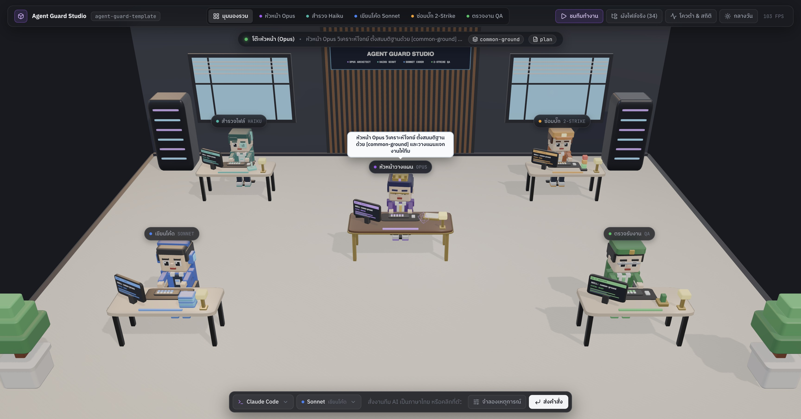

# 🛡️ Agent Guard Template

**ระบบควบคุมวินัย AI Coding Agent แบบ Dual-Engine (`Claude Code` & `Antigravity IDE`) — เน้นแก้โค้ดเฉพาะจุด ประหยัดโควต้าหน้าต่างหลัก 50–70% ด้วย Subagents อัตโนมัติ พร้อมระบบป้องกันคำสั่งอันตรายและความจำระยะยาวเฉพาะโปรเจกต์**

ออกแบบตามหลัก **Single Source of Truth (แก้ที่ `CLAUDE.md` และ `.claude/` จุดเดียว)**, **No Over-Claiming (รายงานตามจริงพร้อมหลักฐานเทสต์)**, และ **No Ceremony Overhead (ไม่เพิ่มพิธีกรรมหรือไฟล์ขยะ)**

---

## 🎯 ทำไมต้องใช้ Template นี้? (ปัญหาที่แก้ได้จริง)

| ปัญหาที่พบบ่อยเมื่อใช้ AI เขียนโค้ดแบบเปล่าๆ | กลไกของ `agent-guard-template` |
| :--- | :--- |
| 💸 **หน้าแชทหลักตันไว & เปลืองโควต้า `Opus`:** สั่งงานใหญ่ทีไร AI กวาดอ่านไฟล์และรันเทสต์วนลูปในหน้าต่างหลักจนโควต้าหมดกลางคัน | 🤖 **Auto-Subagent Offload (ลดภาระหน้าต่างหลัก 50–70%):** บังคับแยกงานสำรวจ (`explorer` / `flash`) และงานเขียนโค้ด+รันเทสต์ (`implementer` / `reviewer`) ออกไปทำใน Subagent อัตโนมัติ เก็บหน้าต่างหลักไว้สั่งการได้ยาวหลายชั่วโมง |
| 🔄 **ต้องคอยแก้ไฟล์กฎ 2 ที่ (`.claude/` กับ `.agents/`):** เวลาปรับกฎหรือจดบทเรียนต้องตามแก้ทั้งสองค่ายจนข้อมูลไม่ตรงกัน | 🔗 **Single Source of Truth (`.claude/` Master):** เก็บกฎและทักษะต้นฉบับไว้ที่ `CLAUDE.md` และ `.claude/` จุดเดียว ส่วนฝั่ง Antigravity (`AGENTS.md`, `GEMINI.md`, `.agents/`) ใช้ตัวชี้ `@[...]` และ `.agents/skills.json` ดึงไปใช้อัตโนมัติ |
| 🔁 **เดาแก้บั๊กมั่ว & แอบแก้เทสต์หนีบั๊ก:** ลองแก้สุ่มวนไป 10 รอบ หรือแอบลบ `expect` ในไฟล์เทสต์เพื่อให้เทสต์ผ่านหลอกๆ | 🛑 **2-Strike Circuit Breaker & Stage 4 Test Lock:** หากแก้บั๊กครบ 2 ครั้งแล้วยังไม่ผ่านจะบังคับหยุดและย้อนโค้ดกลับด้วย `Edit` ทันที และระหว่างซ่อมบั๊ก สคริปต์ยามจะบล็อกไม่ให้ AI แอบแก้ไฟล์เทสต์เดิม (`exit 2`) |
| 🧠 **ลืมข้อตกลงเดิมเมื่อเปิดแชทใหม่:** พอขึ้นแชทใหม่ AI ก็ทำผิดจุดเดิมซ้ำ (เช่น หน่วยเงินสตางค์, สิทธิ์ RLS, หรือวิธีรันเทสต์) | 📝 **Self-Learning Pitfall Memory (`project-pitfalls.md`):** สกัดบทเรียนจาก `[BLOCKER]` และคำสั่งสอนของคุณเก็บเป็นกฎบรรทัดเดียวใน `.claude/rules/project-pitfalls.md` อัตโนมัติ และไม่ถูกเขียนทับเวลาอัปเดต Template |
| 🐘 **โค้ดบวม & คำอ้างเกินจริง:** แก้ปุ่มเดียวแต่รื้อไฟล์ข้างเคียงมาเพียบ หรืออ้างว่า *"เสร็จสมบูรณ์ 100%"* ทั้งที่ไม่ได้รันเทสต์ | ✂️ **Surgical Diffs + No Over-Claiming & Next Steps:** แก้เฉพาะบรรทัดที่สั่ง รายงานผลพร้อมคำสั่งเทสต์จริง สรุป `### ⏭️ ขั้นตอนถัดไป` (1–3 ข้อ) และแสดงตารางพิสูจน์ผล `### 📊 ผลชี้วัด Agent Guard Template` ท้ายงาน |
| 🔌 **โควต้าตัดกลางอากาศ:** กำลังทำค้างใน Claude Code แล้วโควต้าเต็ม ต้องมานั่งพิมพ์เล่าใหม่ใน Antigravity IDE | 🏃 **Auto-Handoff ข้ามค่าย:** บันทึกจุดแก้ล่าสุดลง `.agent-last-state.log` ทุกครั้งที่แก้ไฟล์ พอสลับไปเปิดอีกค่าย แค่พิมพ์ว่า *"ทำต่อจากที่ค้างไว้"* ก็ลุยต่อได้ทันที |

---

## 🚀 วิธีติดตั้งและอัปเดต (ใช้เวลาไม่ถึง 1 นาที)

> **Zero-Dependency:** ไม่ต้องรัน `npm install` หรือ `pip install` ลงในโปรเจกต์ ใช้เพียง `bash`, `git`, และ `python3` มาตรฐานที่มีติดเครื่อง macOS / Linux / WSL อยู่แล้ว

### วิธีที่ 1: เริ่มโปรเจกต์ใหม่
```bash
git clone https://github.com/bosocmputer/agent-guard-template.git my-project
cd my-project
chmod +x .claude/hooks/*.sh
```

### วิธีที่ 2: นำไปติดตั้งหรืออัปเดตในโปรเจกต์ที่มีอยู่แล้ว (`rsync` One-Liner)
รันคำสั่งนี้ที่โฟลเดอร์นอกสุดของโปรเจกต์ เพื่อติดตั้งหรืออัปเดตไฟล์มาตรฐานของ Template โดย**เก็บรักษาบทเรียนเฉพาะโปรเจกต์ (`.claude/rules/project-pitfalls.md`) และสถิติ (`.telemetry.json`) เดิมไว้ครบถ้วน**:

```bash
rm -rf /tmp/agt-update
git clone --depth 1 https://github.com/bosocmputer/agent-guard-template.git /tmp/agt-update
rsync -av --exclude='.git' --exclude='README.md' --exclude='docs' --exclude='.mcp.json' --exclude='.gitignore' --exclude='.telemetry.json*' --exclude='.quota_cache.json*' --exclude='/.claude/rules/project-pitfalls.md' /tmp/agt-update/ ./
[ -f .claude/rules/project-pitfalls.md ] || cp /tmp/agt-update/.claude/rules/project-pitfalls.md .claude/rules/project-pitfalls.md
rm -rf /tmp/agt-update .agents/skills
chmod +x .claude/hooks/*.sh
```

---

## 📂 โครงสร้างไฟล์ (`Single Source of Truth` — แก้ที่ `.claude/` จุดเดียว)

```text
project-root/
├── CLAUDE.md                                   # 🧠 กฎหลักต้นฉบับ (Single Source of Truth สำหรับทั้ง Claude Code & Antigravity)
├── AGENTS.md                                   # 🔗 ตัวชี้เบา (@[CLAUDE.md](./CLAUDE.md)) สำหรับ Antigravity / VS Code / Cursor
├── GEMINI.md                                   # 🔗 ตัวชี้เบา (@[CLAUDE.md](./CLAUDE.md)) ป้องกันการโหลดกฎซ้ำ
├── .mcp.json                                   # ตั้งค่า MCP (เริ่มต้นเป็นค่าว่างเพื่อประหยัด Context)
├── .gitignore                                  # ป้องกันไฟล์ความลับและไฟล์สถานะชั่วคราวขึ้น Git
│
├── .agents/                                    # ⚡ ตัวชี้สำหรับ Antigravity IDE (ไม่ต้องตามแก้ไฟล์ในโฟลเดอร์นี้)
│   ├── hooks.json                              # ผูก Lifecycle Hooks ไปรันสคริปต์ใน .claude/hooks/
│   ├── skills.json                             # ชี้โฟลเดอร์ Skills ไปที่ {"entries": [{"path": ".claude/skills"}]}
│   └── rules/                                  # ตัวชี้กฎพร้อม Frontmatter มาตรฐาน Antigravity (trigger: always_on / glob)
│       ├── model-routing.md                    # @[model-routing](../../.claude/rules/model-routing.md)
│       ├── execution-discipline.md             # @[execution-discipline](../../.claude/rules/execution-discipline.md)
│       ├── project-pitfalls.md                 # @[project-pitfalls](../../.claude/rules/project-pitfalls.md)
│       ├── code-simplicity.md                  # @[code-simplicity](../../.claude/rules/code-simplicity.md)
│       ├── testing-and-api.md                  # @[testing-and-api](../../.claude/rules/testing-and-api.md)
│       └── ui-anti-slop.md                     # @[ui-anti-slop](../../.claude/rules/ui-anti-slop.md)
│
└── .claude/                                    # 🤖 แหล่งข้อมูลต้นฉบับ (Master Single Source of Truth)
    ├── settings.json                           # สิทธิ์คำสั่งปลอดภัย + ผูกสคริปต์ Hooks สำหรับ Claude Code
    ├── agents/                                 # ลูกมือ Subagents 4 ตำแหน่ง (พร้อม Capability Budgets ตาม Harness Engineering Layer 3)
    │   ├── explorer.md                         # สำรวจโค้ด & ค้นคว้าเว็บ WebSearch/WebFetch (haiku / flash, maxTurns: 10 + Zero-Citation Stop)
    │   ├── implementer.md                      # แก้โค้ดแบบ Surgical Edit + รันเทสต์ Tier 1–2 เองในตัว (sonnet / inherit, 20-Turn Target / maxTurns: 40)
    │   ├── debugger.md                         # วิเคราะห์ต้นตอและตัดลูป 2-Strike (sonnet / inherit, 8-Turn Target / maxTurns: 12)
    │   └── reviewer.md                         # ตรวจเฉพาะ Blocker หลัง Computational Sensors ผ่าน (research/flash, maxTurns: 35)
    ├── rules/                                  # กฎต้นฉบับ 6 ไฟล์
    │   ├── model-routing.md                    # เกณฑ์แยกงานให้ Subagents, กฎ 1 Slice ต่อคำสั่ง & ห้ามรัน Browser/WebFetch ในหน้าต่างหลัก
    │   ├── execution-discipline.md             # ส่งต่องาน State-Delta (<=8 บรรทัด), Grep ก่อนอ่านเฉพาะบรรทัด (>200 บรรทัด) & ห้าม git reset/restore
    │   ├── project-pitfalls.md                 # ความจำระยะยาวเฉพาะโปรเจกต์ตามหลัก The Ratchet Pattern (สกัดอัตโนมัติ สูงสุด 30 ข้อ)
    │   ├── code-simplicity.md                  # กฎ Karpathy: คิดก่อนทำ, เรียบง่ายที่สุด, แก้เฉพาะจุด, ไม่สร้างไฟล์ขยะ
    │   ├── testing-and-api.md                  # บังคับเทสต์โค้ดจริง (Verify RED ➔ GREEN) & ตรวจสิทธิ์ BOLA/IDOR
    │   └── ui-anti-slop.md                     # มาตรฐานออกแบบ UI 9 ด้าน (ใช้ lucide, tabular-nums, ห้ามวาด SVG เอง)
    ├── skills/                                 # ตำราเฉพาะทาง 9 ตัว (โหลดเฉพาะเมื่อตรงกับงาน — Progressive Disclosure)
    │   ├── auto-resume-handoff/SKILL.md        # กู้คืนงานค้างอัตโนมัติเมื่อสลับค่ายหลังโควต้าเต็ม
    │   ├── common-ground/SKILL.md              # สกัดสมมติฐาน 3–4 ข้อมาถามก่อนทำฟีเจอร์ที่คลุมเครือ
    │   ├── db-migration/SKILL.md               # กฎสร้าง SQL Migration แบบ Zero-Downtime, RLS & SECURITY DEFINER
    │   ├── pragmatic-review/SKILL.md           # รีวิวเฉพาะจุดตาย [BLOCKER] จบภายในไม่เกิน 2 รอบ
    │   ├── root-cause-debug/SKILL.md           # ซ่อมบั๊ก 4 ขั้นตอนภายใต้เบรกเกอร์ 0-Strike / 2-Strike
    │   ├── security-audit/SKILL.md             # ตรวจความปลอดภัยเชิงลึก entrypoint ➔ sink (Cloudflare Protocol)
    │   ├── tech-stack-skills/SKILL.md          # ดึงเฉพาะเครื่องมือจัดการเอกสาร/เวิร์กโฟลว์ (pdf, xlsx, webapp-testing, mcp-builder)
    │   ├── threejs-expert/SKILL.md             # มาตรฐาน Three.js r187+ (three/addons/*, OutputPass, dispose)
    │   └── verification-before-completion/     # กฎเหล็กห้ามส่งงานโดยไม่รันเทสต์สด & ดักจับ 0 tests ran
    ├── commands/                               # คำสั่งลัด (/plan, /common-ground, /fix, /review, /security-audit, /verify, /learn, /handoff)
    └── hooks/                                  # 🛡️ สคริปต์ยามรักษาความปลอดภัย 0-Token (ทำงานทั้ง Claude Code & Antigravity)
        ├── auto-resume.sh                      # ฉีดสถานะงานค้างตอนเปิดแชทใหม่ (SessionStart) และบันทึกความจำก่อนย่อแชท (PreCompact)
        ├── validate-bash.sh                    # บล็อก rm -rf, git restore/reset ทับโค้ด, ลง pkg มั่ว & กั้น Deploy Production
        ├── protect-sensitive-files.sh          # บล็อกการอ่าน/แก้ .env/.key, lockfiles & บล็อกการแอบแก้ไฟล์เทสต์เดิมขณะซ่อมบั๊ก
        ├── loop-circuit-breaker.sh             # ตัดวงจรเมื่อรันคำสั่งเทสต์/บิลด์เดิมซ้ำเกิน 3 ครั้งโดยไม่แก้โค้ด
        ├── post-edit-format.sh                 # จัด Format อัตโนมัติ + บันทึก Checkpoint + ล้างตัวนับลูปเมื่อแก้โค้ดจริง
        ├── telemetry-tracker.sh                # บันทึกสถานะการทำงานสดและแคชสถิติ Subagents ลง .claude/.telemetry.json
        ├── audit-session-proof.sh              # สแกนไฟล์ .jsonl สรุปผลการใช้โมเดล, Subagent tokens, Hooks และบทเรียนที่สกัดได้
        ├── install-skill.sh                    # ดึง Skill เสริมเฉพาะทางลง .claude/skills/ แบบ Sparse Checkout
        └── open-hud.sh                         # เปิดหน้าจอมอนิเตอร์ 3D Voxel Studio (อุปกรณ์เสริม)
```

---

## 🧠 เจาะลึก 6 กลไกหลักของระบบ

### 1. การคัดแยกงานและแตก Subagent อัตโนมัติ (`Zero-Command Auto-Routing`)
คุณสามารถพิมพ์สั่งงานด้วยภาษาไทยตามปกติ ระบบใน [`CLAUDE.md`](CLAUDE.md) จะประเมินขนาดงานให้อัตโนมัติ:
* **งานแก้จุดย่อยที่รู้พิกัดไฟล์อยู่แล้ว (`1–2 ไฟล์`):** หน้าต่างหลักลงมือแก้แบบ Surgical Edit และรันเทสต์เฉพาะไฟล์ทันที (**ไม่แตก Subagent ให้เสียเวลา Cold-Start ฟรี** ตามกฎ `No Ceremony Overhead`)
* **งานสำรวจโค้ดข้ามหลายโฟลเดอร์ (`>3 ไฟล์`) หรือค้นคว้าข้อมูลจากอินเทอร์เน็ต:** แตก `explorer` (`haiku` บน Claude พร้อม `WebSearch`/`WebFetch` / `research` `flash` บน Antigravity พร้อม `search_web`) ไปสแกนหาบรรทัดหรือค้นเอกสารเว็บ แล้วส่งกลับมาเฉพาะสรุปสั้นๆ ไม่เกิน 15 บรรทัด
* **งานสร้างฟีเจอร์หรือแก้โค้ดหลายไฟล์ (`2–5 ไฟล์`):** แตก `implementer` (`sonnet` / `self`) ด้วยหน้าต่างสะอาด (**Fresh Context — ห้าม Fork ประวัติแชทหลัก**) พร้อมส่งเฉพาะ `State-Delta Brief (<=8 บรรทัด)` ไปเขียนโค้ดและ **รันเทสต์ Tier 1 + Tier 2 (`analyze` + `test`) ให้จบในตัว** (ห้ามแตก `QA Verifier` ตัวใหม่ขึ้นมาเพื่อรัน CLI 1–3 คำสั่งซ้ำซ้อน) หากมีการปรับแก้ต่อในฟีเจอร์เดิมและยังไม่เกิน `40 รอบ` ให้ส่ง `send_message` ใช้ `implementer` ตัวเดิมต่อเพื่อประหยัด Cold-Start Tokens แต่ถ้าเปลี่ยนไปทำงานคนละเรื่องให้แตกตัวใหม่ทันที
* **กฎประหยัด Token ตอนอ่านไฟล์ใหญ่ (`Grep First, Read Line-Range Second`):** สำหรับไฟล์ที่ยาวเกิน `200 บรรทัด` บังคับใช้ `Grep`/`grep_search` หาเลขบรรทัดก่อน แล้วอ่านเฉพาะช่วงบรรทัด (`StartLine`–`EndLine` หรือ `offset`–`limit` ±40 บรรทัด) แทนการดึงไฟล์เต็มเข้า Context ซ้ำๆ (ประหยัด Input Tokens 70–80%)
* **งานซ่อมบั๊ก (`debugger`) และงานตรวจรับโค้ด/รัน E2E (`reviewer`):** แยกออกไปรันใน Subagent (`Pragmatic Code Reviewer` ใช้ `research` + `flash` แบบ Read-Only / งานเปิดเว็บใช้ `browser` + `flash`) เพื่อไม่ให้ Log ของเทสต์และ Browser กินพื้นที่หน้าต่างแชทหลัก

### 2. ยามรักษาความปลอดภัยเบื้องหลัง 0-Token (`.claude/hooks/*.sh`)
ทำงานด้วยสคริปต์ Bash/Python ก่อนและหลังการเรียกเครื่องมือของ AI โดยไม่เสีย Token (พร้อมการันตี Fail-Open สำหรับส่วน Telemetry):
1. **`validate-bash.sh` (Git, Dependency, Production & MITRE Execution/Exfiltration Gate):**
   * บล็อกคำสั่งทำลายงานค้าง เช่น `rm -rf`, `git reset --hard`, `git checkout .`, `git restore`, `git push --force` (แต่อนุญาตการสร้างและสลับกิ่ง `git checkout -b` / `git switch` ตามปกติ)
   * บล็อกการรันสคริปต์ภายนอกเข้าสู่ Shell โดยตรง (`curl/wget ... | sh/bash/python/node`), การพลางคำสั่ง (`base64 -d | sh`, `$IFS`), และการดึงค่า Environment Secrets ทั้งระบบด้วย `printenv` หรือ `env` เปล่าๆ
   * บล็อกการแอบอ่าน `.env*`/`*.key` ผ่านคำสั่ง Shell (`cat/grep/awk/sed`) และการแตะต้องโฟลเดอร์ Credential หรือ Shell Profile ของโฮสต์ (`~/.ssh`, `~/.aws`, `~/.kube`, `~/.zshrc`, `crontab`)
   * บล็อกการแอบติดตั้ง Package ใหม่ (`npm install`, `flutter pub add`, `go get`, `pip install`, `cargo add`) จนกว่าคุณจะอนุมัติ (`DEPS_APPROVED=1`)
   * บล็อกการสั่ง Deploy ขึ้น Production หรือยิง Migration ขึ้นฐานข้อมูลจริง (`vercel --prod`, `supabase db push`, `prisma migrate deploy`) จนกว่าคุณจะอนุมัติ (`RELEASE_APPROVED=1`) แต่อนุญาต `supabase db reset` บน Local Docker สำหรับรันเทสต์
2. **`protect-sensitive-files.sh` & `telemetry-tracker.sh` (Secrets, Host Credentials & Stage 4 Anti-Test-Tampering):**
   * ห้ามอ่านหรือแก้ไขไฟล์ `.env*`, `*.key`, `*.pem`, `*.sqlite`, `*.db`, โฟลเดอร์ Credential ของโฮสต์ (`~/.ssh/*`, `~/.aws/*`, `~/.kube/*`, `~/.netrc`, `~/.npmrc`), Shell Profile (`~/.zshrc`, `~/.bashrc`), ไฟล์ `.git/config` / `.git/hooks/*` และไฟล์ Lockfile
   * ขณะอยู่ในโหมดซ่อมบั๊ก (`strikeCount >= 1`) จะบล็อกไม่ให้ AI แอบแก้ไขไฟล์เทสต์เดิม (`*.test.*`, `*.spec.*`, `*_test.*`) บังคับให้แก้ที่โค้ดต้นเหตุเท่านั้น
3. **`post-edit-format.sh` & `loop-circuit-breaker.sh`:**
   * จัด Format โค้ดอัตโนมัติหลังแก้ไฟล์ บันทึกจุดค้างงานลง `.agent-last-state.log` และล้างตัวนับลูปคำสั่งเมื่อมีการแก้โค้ดจริง (ทำให้รันเทสต์ตรวจหลังแก้ไฟล์ได้ต่อเนื่องโดยไม่โดนบล็อกผิดพลาด)

### 3. ความจำระยะยาวเฉพาะโปรเจกต์ (`.claude/rules/project-pitfalls.md`)
AI จะสกัดบทเรียนสั้นๆ บรรทัดเดียว (`- **[หมวดหมู่]:** <สิ่งที่ต้องทำ/ห้ามทำ + เหตุผลสั้นๆ>`, สูงสุด 30 ข้อ) ลงใน `.claude/rules/project-pitfalls.md` อัตโนมัติใน 3 จังหวะ:
1. เมื่อซ่อมบั๊กหรือแก้ `[BLOCKER]` สำเร็จ
2. เมื่อคุณทักท้วงหรือสั่ง `/learn`
3. เมื่อจบ Milestone หรือสั่ง `/handoff`

### 4. นโยบายการลง Skill เสริมตามหลัก *SkillsBench* (`tech-stack-skills`)
* **ห้ามลง Skill สอนภาษา/เฟรมเวิร์กพื้นฐานอัตโนมัติ** (เช่น `react-expert`, `flutter-expert`, `python-pro`) เพราะโมเดลยุคใหม่มีความรู้ไวยากรณ์อยู่ใน Weights แล้ว การอ่านโค้ดจริงในโปรเจกต์ 1–2 ไฟล์คู่กับ `project-pitfalls.md` ให้ผลแม่นยำกว่าและไม่เปลือง Context
* ใช้คำสั่ง `bash .claude/hooks/install-skill.sh <ชื่อ-skill>` **เฉพาะเมื่อต้องการเครื่องมือจัดการเอกสารหรือเวิร์กโฟลว์เฉพาะทาง** จาก [`anthropics/skills`](https://github.com/anthropics/skills) เท่านั้น เช่น:
  ```bash
  bash .claude/hooks/install-skill.sh pdf xlsx docx pptx webapp-testing mcp-builder
  ```

### 5. มาตรฐานการส่งมอบงาน & ลวดสะดุดแจ้งเตือนอัตโนมัติ (`Next Steps` + `Harness Tripwires` ใน `audit-session-proof.sh --brief`)
ทุกครั้งที่ AI ส่งมอบงานเสร็จ จะปิดท้ายด้วย 2 ส่วนนี้เสมอ:
1. **`### ⏭️ ขั้นตอนถัดไป (Next Steps)` (1–3 ข้อกระชับ):** บอกชัดเจนว่าคุณต้องทำอะไรต่อ (เช่น มีไฟล์ Migration ใหม่ที่ต้องรัน `supabase db push`, จุดที่ควรเปิดตรวจบนหน้าเว็บ, หรือลำดับงานถัดไป) และ **หยุดรอคำสั่งถัดไป (One Slice Per Prompt — ห้ามรันลูกโซ่ข้ามขั้นเองจนโควต้าหมด)**
2. **`### 📊 ผลชี้วัด Agent Guard Template — เฉพาะคำสั่งนี้` (5 บรรทัดจากสคริปต์จริง แยกเฉพาะคำสั่งล่าสุด + ยอดสะสมทั้งแชท + `Harness Tripwires`):**
   ```markdown
   ### 📊 ผลชี้วัด Agent Guard Template — เฉพาะคำสั่งนี้ (Antigravity Session `#7217c67b`)
   - **สัดส่วนโมเดลคำสั่งนี้ (26 รอบ):** Parent (Fable 5.2) `73.1%` (19 รอบ) | Subagents (Sonnet) `26.9%` (7 รอบ) | Subagents (Haiku) `0.0%` (0 รอบ) ➔ **Offload รอบนี้: `26.9%`** *(สะสมทั้งแชท: 535 รอบ, Offload 58.9%)*
   - **Subagents ที่เรียกในคำสั่งนี้:** `2` ตัว (`Explorer: 0`, `Implementer: 2`, `Debugger: 0`, `Reviewer: 0`) — รับภาระรอบนี้ `450,873 tokens` *(สะสมทั้งแชท: 10 ตัว)*
   - **Hooks ที่ทำงานในคำสั่งนี้:** สแกนไฟล์ `2` ครั้ง | แก้ไฟล์+Checkpoint `0` ครั้ง | รันเทสต์ `0` ครั้ง | บล็อกผิดกฎ `0` ครั้ง | 2-Strike: `0/3` *(สะสมทั้งโปรเจกต์: สแกน 63, แก้ 71, เทสต์ 13)*
   - **ความจำ & ส่งต่องาน:** Pitfalls `7/30` (รอบนี้ไม่มีเพิ่มใหม่) | `TASK_STATE.md`: ✅ ซิงก์อัตโนมัติ (`feat/sprint1-foundation@3bddbed`)
   - **⚡ Harness Tripwires (Layer 6 SLA):** ✅ `ปกติ (No Behavioral Drift)` — รอบคำสั่ง `12/20` · สะสมหน้าต่างหลัก `50/80`
   ```
   *(หากหน้าต่างหลักสะสมเกิน 80 รอบ, คำสั่งเดียวรันเกิน 20 รอบ, หรือ Offload ต่ำกว่า 30% บรรทัด `⚡ Harness Tripwires` จะเปลี่ยนเป็นป้ายเตือน `⚠️ CONTEXT_WINDOW_BLOAT` / `⚠️ TURN_BUDGET_EXCEEDED` เพื่อเตือนให้พิมพ์ `/compact` หรือเปิดแชทใหม่ทันที)*

### 6. ส่งต่องานข้ามค่ายและกันความจำเสื่อมตอนย่อแชทอัตโนมัติ (`2-Layer TASK_STATE.md + PreCompact Continuity Ledger`)
คุณสามารถสลับไปมาระหว่าง **Claude Code ⇄ Antigravity IDE** ได้ทันทีเมื่อโควต้าฝั่งใดฝั่งหนึ่งเต็ม หรือคุยงานต่อเนื่องยาวๆ โดยไม่ต้องพิมพ์คำสั่ง `/handoff` เอง:
* **ชั้นที่ 1 (สรุปงานอัตโนมัติโดย AI):** ทุกครั้งที่แก้โค้ดหรือปิดงานย่อยเสร็จ AI จะอัปเดตสรุปสถานะปัจจุบันและงานถัดไปไว้ด้านบนของ `TASK_STATE.md` (ไม่เกิน 20 บรรทัด)
* **ชั้นที่ 2 (ซิงก์สถานะ Git แบบ `0-Token` ใน `audit-session-proof.sh`):** สคริปต์จะดึงกิ่งปัจจุบัน (`Branch`), 5 คอมมิตล่าสุด (`git log -n 5`), ไฟล์ที่แก้ค้าง (`git status --short`), และพิกัดไฟล์ล่าสุด (`.agent-last-state.log`) ไปเขียนต่อท้าย `TASK_STATE.md` ให้อัตโนมัติทุกครั้งที่จบงาน
* **ชั้นที่ 3 (`PreCompact` Continuity Hook):** ก่อนที่ระบบจะสั่งย่อหน้าต่างความจำอัตโนมัติ (`/compact` หรือ Auto-Compaction) `auto-resume.sh --pre-compact` จะบังคับซิงก์ `TASK_STATE.md` ล่าสุดและฉีดเตือนให้ AI ยึด `TASK_STATE.md` + `project-pitfalls.md` เป็นหลักหลังย่อความจำ ป้องกันอาการความจำเสื่อมกลางแชท (`Post-Compaction Amnesia`)

---

## ⚡ ตารางคำสั่งลัด (ใช้ได้ทั้งใน Claude Code และ Antigravity IDE)

| คำสั่งลัด | ใช้เมื่อไหร่ | สิ่งที่เกิดขึ้นเบื้องหลัง |
| :--- | :--- | :--- |
| **`/plan <โจทย์>`** | ก่อนเริ่มงานใหญ่ที่ต้องแก้เกิน 3 ไฟล์ | ส่ง `explorer` สแกนหาพิกัดไฟล์และสรุปแผนสั้นๆ มาให้ตรวจอนุมัติก่อนแก้โค้ด |
| **`/common-ground <โจทย์>`** | ก่อนทำฟีเจอร์ใหม่ที่มีเงื่อนไขธุรกิจหลายแง่มุม | สกัดสมมติฐาน 3–4 ข้อและขอบเขตที่จะไม่ทำ (*YAGNI*) มาถามให้ตรงกันก่อนลงมือ |
| **`/fix <อาการบั๊ก>`** | เมื่อเทสต์พังหรือเจออาการบั๊ก | วิเคราะห์ต้นตอ 4 ขั้นตอน + ล็อกไฟล์เทสต์เดิม (`Stage 4`) + ตัดเบรกเกอร์เมื่อแก้ไม่ผ่านครบ 2 ครั้ง (`2-Strike`) |
| **`/review`** | เมื่อเขียนโค้ดเสร็จและต้องการตรวจก่อนส่ง | ส่ง `reviewer` ตรวจเฉพาะ `[BLOCKER]` และช่องโหว่ความปลอดภัย (จบภายในไม่เกิน 2 รอบ) |
| **`/security-audit`** | เมื่อต้องการตรวจความปลอดภัยเชิงลึกก่อนปล่อยของ | ส่ง `explorer` หาพื้นผิวโจมตี + `reviewer` ไล่เส้นทาง `entrypoint ➔ sink` ตามเกณฑ์ Cloudflare |
| **`/verify`** | ก่อนประกาศจบงานหรือปิด Milestone | รันเทสต์จริง + ตรวจ Type/Analyze + สรุป `Next Steps` และรัน `audit-session-proof.sh --brief` |
| **`/learn <บทเรียน>`** | เมื่อต้องการสั่งให้จำข้อตกลงเฉพาะโปรเจกต์ | บันทึกกฎสั้นๆ 1 บรรทัดลง `.claude/rules/project-pitfalls.md` (ไม่เกิน 30 ข้อ) |
| **`/handoff`** | ก่อนล้างแชท `/clear` หรือก่อนสลับค่าย AI | สรุปสถานะงานค้างลง `TASK_STATE.md`, สกัดบทเรียนของรอบนั้นลง `project-pitfalls.md`, และแสดงผลชี้วัดประจำแชท |

---

## 🖥️ อุปกรณ์เสริม (Optional): หน้าจอมอนิเตอร์ 3D (`Agent Guard Voxel Studio`)

หากต้องการเปิดหน้าจอจำลองการทำงานของทีม AI ทั้ง 5 แผนกแบบเรียลไทม์ สำรวจผังไฟล์จริง หรือดู % โควต้าคงเหลือ สามารถรันคำสั่งนี้ใน Terminal (เปิด `http://127.0.0.1:4317/` อัตโนมัติ):

```bash
bash .claude/hooks/open-hud.sh
```



---

## 📚 มาตรฐานและงานวิจัยอ้างอิง

* **Harness Engineering (*Agent = Model + Harness: The 6-Layer Production Playbook*, 2026):** สถาปัตยกรรม 6 ชั้น (*Guides, Computational vs. Inferential Sensors, Capability Budgets, 4-Tier Externalized Memory, Graduated Permissions, และ Layer 6 Behavioral Drift Tripwires*) รวมถึง *The Ratchet Pattern* ของ Mitchell Hashimoto (Ghostty)
* **[Anthropic AI-Native SDLC Playbook](https://claude.com/resources/articles/the-ai-native-sdlc-playbook) & [`anthropics/skills`](https://github.com/anthropics/skills):** กลไก *Stage 3 Pitfall Memory Distillation*, *Stage 4 Anti-Test-Tampering Guard*, *Stage 5 Production Approval Gate*, และคลังทักษะจัดการเอกสารทางการ
* **[`SkillsBench` (2026)](https://arxiv.org/abs/2602.12670) & *The Bitter Lesson*:** ตัดทักษะสอนไวยากรณ์ภาษาพื้นฐานที่ซ้ำกับ Pre-trained Weights ออก คงไว้เฉพาะ *Hard Guardrails*, *Project-Specific Pitfalls*, และ *Capability Tooling*
* **[`cloudflare/security-audit-skill`](https://github.com/cloudflare/security-audit-skill):** การไล่เส้นทางช่องโหว่ `entrypoint ➔ propagation ➔ sink` และการตรวจสิทธิ์ `Multi-Tenant Data Isolation (BOLA/IDOR)`
* **[`forrestchang/andrej-karpathy-skills`](https://github.com/forrestchang/andrej-karpathy-skills) & [`obra/superpowers`](https://github.com/obra/superpowers):** กฎ *Surgical Changes*, *4-Phase Root-Cause Debugging*, และ *Verification Before Completion*
* **[`garrytan/gstack`](https://github.com/garrytan/gstack) & [`trailofbits/claude-code-config`](https://github.com/trailofbits/claude-code-config):** ระบบป้องกัน *Reward Hacking (`RH-1..RH-16`)*, การดักจับ *Zero-Run Green (`PL-2`)*, และการส่งต่องานระหว่าง Subagents แบบ `State-Delta`
